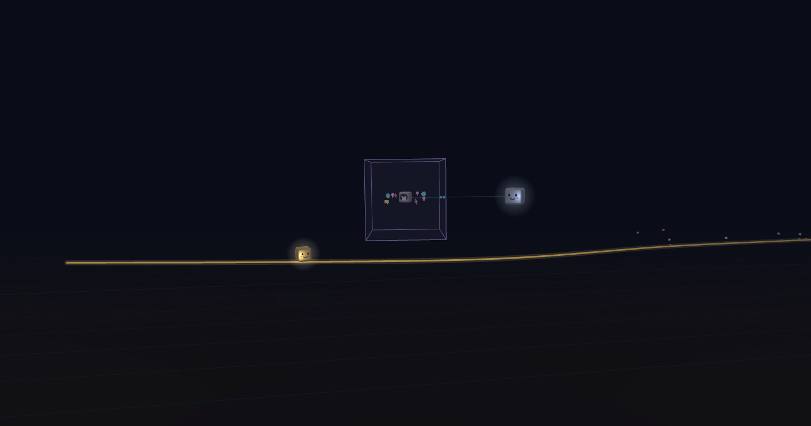

[Read in English](README.md)



# STL Studio, la interfaz entre tú y el modelo

STL Studio es una pequeña aplicación web local que se sienta entre tú y un modelo de IA y lo convierte en el director asistente de tu proyecto. Cuando se construye solo, o en un equipo pequeño, los proyectos rara vez mueren por falta de ideas: mueren por la atención dispersa. Diez chats abiertos, planes a medias, un «¿sigo?» perdido hace tres sesiones, y cada chat nuevo empezando de cero, pidiéndote con cortesía que le expliques todo otra vez.

El método STL lo resuelve con un solo canal. Todo lo que le dices al director (un comentario, una nota de voz, una pregunta, una decisión) entra al Studio. En cada revisión, que solo tú pides, el director lo lee todo, mantiene la ruta hacia tu meta y le da a cada persona una misión a la vez, con su porqué y un botón al lugar exacto. Tú decides; el director propone, ordena el trabajo y ejecuta solo lo que aprobaste, con pruebas y commits locales.

La memoria vive en el repositorio de tu propio proyecto, en una rama aparte, stl, así que nada depende del contexto de un chat: el modelo puede olvidar, el proyecto no. Menos pestañas, más cosas terminadas.

Versión 0.1.0. El repositorio es [ARGWABOT/STL-Sacred_Time_Line](https://github.com/ARGWABOT/STL-Sacred_Time_Line). La interfaz viene en español y en inglés.

## Empieza en tres pasos

1. **Baja STL Studio** ([la última versión](https://github.com/ARGWABOT/STL-Sacred_Time_Line/releases/latest)), descomprímelo y abre Claude Code en su carpeta.
2. **Pídele «inicializa STL Studio»**: instala todo y abre el Studio en tu navegador.
3. **Entrega tu proyecto** con «Entregar proyectos»: el director lo diagnostica y te da tu primera misión.

El detalle de cada paso está abajo, en «Instalar».

## Instalar

La instalación es la misma en cualquier computador. La forma más corta: baja el Studio, abre su carpeta con Claude Code y pídele **«inicializa STL Studio»**. El agente sigue [INSTALAR.md](INSTALAR.md) de principio a fin (en inglés, como todo lo que lee el modelo, [INSTALL.md](INSTALL.md)): revisa tu computador, te dice qué falta, te pide permiso antes de instalar cada cosa, enciende el Studio y lo abre en tu navegador. Tú solo dices «sí» y le das tu identidad de git. El paquete viene sin sus dependencias: el agente corre `npm install` al inicializarlo.

A mano:

```bash
git clone https://github.com/ARGWABOT/STL-Sacred_Time_Line.git stl-studio
cd stl-studio
npm run iniciar
```

`npm run iniciar` comprueba Node, git y tu identidad, instala las dependencias y, si no falta nada, enciende el Studio aparte y lo abre en **http://localhost:5180/** (es lo mismo que `npm run encender`). La primera vez, si este computador no tiene proyecto propio ni modelo elegido, se abre el **asistente de instalación**, a pantalla completa: comprueba tu sesión de Claude Code (si falta, te guía y no deja seguir), pregunta tu plan de Claude, te deja marcado el modelo y los permisos recomendados, cada uno con por qué y cuándo hace falta, y con «Dejar todo como viene» aceptas lo marcado y ves en una lista lo que quedó. **Quien acepta todo con un clic le permite al director subir y publicar**: desmarca lo que no quieras dar. Después instala la transcripción de tus notas de voz, que es obligatoria, con su avance, y te pide leer una frase para ver que entiende; si la descarga falla, dice si fue internet o espacio, y sin micrófono sigues igual. Después baja solas las voces que leen en voz alta, tres por idioma: son parte del Studio, sin casilla para saltarlas; si su descarga falla, ofrece «Reintentar», y la única forma de quitarlas es desinstalar el Studio. Al final, STL Studio queda activo y te lleva a entregar tu primer proyecto. Si lo cierras a mitad, vuelve donde quedó; lo repasas cuando quieras con «Repasar la instalación», en «Modelo y consumo», y «Verla como quien instala», a su lado, la muestra como la primera vez, sin guardar nada.

El Studio queda corriendo aunque cierres la terminal o el agente, y si su servidor se cae, se levanta solo. Después de reiniciar el computador, vuelve a correr `npm run encender` (si ya está encendido, solo lo abre; si lo que está encendido es otra copia del Studio, desde otra carpeta, la apaga y enciende esta: un solo Studio a la vez). En Windows, sin terminal: doble clic en **`Abrir STL Studio.cmd`**, en la carpeta del Studio, hace lo mismo (para tenerlo a mano: clic derecho › Enviar a › Escritorio).

### Lo que necesita

- **Node.js 24** o más nuevo y **git**, con tu identidad configurada (`git config user.name` y `git config user.email`).
- Tu correo de git es tu lugar en el equipo de cada proyecto: para cambiarlo después no basta `git config`, corre `node tools/cambiar-correo.ts <correo nuevo>` en la carpeta del Studio, que lo cambia en git y en el equipo de cada proyecto a la vez.
- **Claude Code, con tu propia cuenta.** El Studio lanza el Claude Code que tú instalas y abres con tu cuenta; no ofrece el inicio de sesión de claude.ai, porque la documentación del SDK de agentes de Anthropic no deja que un producto de terceros lo ofrezca sin su aprobación.
- **Una pantalla ancha**: el Studio se usa en un computador con una pantalla de al menos 1350 píxeles de ancho (un portátil o más). Con menos, una cubierta te pide una pantalla más ancha; no hay versión para teléfonos ni tabletas.
- **Internet, para instalar.** Tu agente mira el disco antes de bajar nada, y el asistente dice cuánto ocupa lo que instala.

### Lo que se probó

- **El agente**: solo se promete Claude Code. Codex y Cursor están por probar.
- **El computador**: Windows 11 Pro, 64 GB de memoria, AMD Ryzen 7 5800X, donde el Studio se usa todos los días. Transcribir una nota tarda más o menos lo que dura. macOS y Linux están por probar, y también una instalación en un computador limpio.
- **La cuenta**: el plan Max 20x de Claude, con Opus 5.5 en esfuerzo «Alto», que en ese uso casi nunca acaba el límite de cada cinco horas ni el semanal. Con un plan menor, usa Sonnet 5.5 y un límite de tiempo más corto en «Modelo y consumo».
- **Lo que gasta una revisión**: una revisión corriente gasta cerca de 1 % del límite semanal de ese plan. Es aproximado, leído de lo que subió el límite en un día y medio de revisiones.

### Después de instalar

1. Inicia sesión una vez en la CLI de Claude Code (`claude auth login`): así «Pedir revisión» llama al director al instante, sin pantalla. La sesión del director, para lo demás, es Claude Code abierto **en la carpeta del Studio** (sin la CLI, deja corriendo ahí `/loop 5m /vigila`).
2. En el selector de proyecto (arriba de la barra lateral), oprime **«Entregar proyectos»** y elige su carpeta. El director lo diagnostica y te propone metas.
3. Lee el diagnóstico, coméntalo parte por parte y **fija tu meta** en Proyecto.
4. **Pedir revisión**: el director traza la ruta y te da tu primera misión. Desde ahí, el ciclo: misión → marcar sus pasos (el último la entrega) → pedir revisión.

La primera vez, tu Studio ya llega con un proyecto, **STL Studio**, fijo al final de la lista: es tu propio Studio, con su diagnóstico hecho, y no tienes que cambiar nada. Para ajustarlo a tu forma de trabajar, selecciónalo y pídeselo al director en el Buzón. Antes de cada revisión de ese proyecto queda una rama de respaldo local; si un ajuste te deja sin Studio, vuelve a ella desde su carpeta:

```bash
git reset --hard respaldo/studio
```

### Actualizar

En la 0.1.0 todavía no hay de qué actualizar. Desde la 0.2.0, el Studio lo ofrece, con su informe de lo que choca con lo que cambiaste. Una línea al pie de la barra, junto a tu nombre, avisa si salió una versión nueva, con su enlace a las notas de esa versión en GitHub y una ✕ que la cierra hasta la siguiente: una vez al día el Studio le pregunta a GitHub cuál es la última, sin enviar nada tuyo ni de tus proyectos; se apaga con su casilla en «Modelo y consumo».

## Por qué

Dirigir un proyecto de semanas por chat tiene seis problemas: lo que envías se ejecuta al instante, corregir contamina el contexto, cada mensaje cuesta la conversación entera, no se puede comentar un párrafo, lo revisado vuelve a reescribirse y nadie decide qué sigue. STL los resuelve con un método y una interfaz:

| En el chat | En STL Studio |
| --- | --- |
| Envías y ya se está ejecutando | Tus comentarios esperan en el **Buzón**: los corriges o los borras antes de la revisión |
| Explicas a qué parte te refieres | **Comentas el párrafo, el paso o la decisión exacta** |
| Diez ideas, diez turnos | **Una revisión agrupada**: el director responde cada observación y dice qué hizo con ella |
| El modelo reescribe lo aprobado | **Siempre hacia adelante**: lo revisado queda sellado; lo que cambia llega en un documento nuevo |
| Trabajas en todo a la vez | **Una ruta con puertas** y una misión a la vez, hacia la meta que fijaste |

El método completo está en [docs/metodo/metodologia.es.md](docs/metodo/metodologia.es.md), y en inglés, en [docs/metodo/metodologia.md](docs/metodo/metodologia.md). Al pie de la barra, **«Qué es STL Studio»** abre la animación pública que lo explica en dos minutos.

## Qué trae

- **Entregar es elegir la carpeta**: el director lo diagnostica y te propone metas (también varios a la vez, los que encuentre al escanear tu equipo, o uno nuevo).
- **Hoy**, el inicio: se abre con un clic en la marca de arriba de la barra lateral. Muestra lo último que se completó, lo que sigue y tu misión de ahora, completa, paso a paso, cada paso con su botón al lugar exacto. Si entregaste todas, nunca queda vacío: dice tu paso siguiente (pedir la revisión, con su botón, o esperar la que ya corre). Lo entregado no vuelve atrás: un clic en una misión que espera al director despliega su resumen.
- **El botón central del ratón, como un Enter**: en «Hoy», esté donde esté el cursor, abre primero «¿Dónde quedamos?» mientras tenga líneas por leer y, con todo leído, tu misión de ahora en modo enfoque; ahí, sin niebla por destapar, te lleva a donde pide su paso (el documento, la propuesta o el lugar), sin elegir nunca una opción por ti. En cualquier otro lugar, oprime lo marcado como lo que sigue; y si no hay nada que destapar ni que oprimir, hace lo de la carita del director: te lleva a «Hoy» y a tu misión de ahora.
- **Hoy y la ruta, una sola vista**: arriba, una barra delgada de la ruta que dice siempre en qué fase vas y cuánto lleva; debajo, tu misión de ahora, la cola plegada y tu ficha. Lo que no hace falta ver cada día (la puerta de la fase y sus criterios, las fases pasadas y las que vienen, el plan de la fase y sus misiones aprobadas, lo pedido y las propuestas) va en la pestaña «Datos del proceso», y un clic en una fase de la barra abre esa pestaña en esa fase. Ni la cuenta de la reserva ni los frentes están a la vista. Desde «¿Dónde quedamos?», «Ir a lo que sigue» con el botón central abre tu misión ya en modo enfoque.
- **Documentos comentables** por partes, con decisiones que se responden una a una, escritas o grabadas.
- **Los archivos clave de cada proyecto**: en «Documentos», dentro de «Documentación del proyecto», están los archivos que hay que conocer para entender el proyecto (los elige el director), con lo que es cada uno al pasar el ratón; y en «Proyecto», debajo de «Qué es», como una tabla corta de nombre y para qué sirve, que abre cada uno con un clic.
- **Buzón y preguntas**: los comentarios, los pedidos y las preguntas, en el Buzón; las respuestas a tus preguntas se leen además juntas, como un informe con conversaciones que puedes seguir, desde el filtro «Pregunta». Los números de sus pestañas y sus filtros cuentan solo lo que espera al director o tu decisión. Cada nota lleva su tipo, que eliges de un toque al dejarla (parte en «Auto (el modelo decide)», y lo cambias por ajuste, comentario, idea para después, algo falla o pregunta; la que dejas desde el ✉ de un lugar ya va marcada como comentario, y la tecla N abre y cierra ese diálogo), y hasta que el director la lea le cambias el tipo con ese mismo botón, en el Buzón. El Buzón se filtra por tipo y por cómo quedó; lo que quedó por decidir o aplazado pasa solo a integrada cuando lo resuelves en su lugar. Todo lo que le dices al director se escribe en un solo diálogo, que la tecla N abre sobre lo que estás mirando; si lo cierras sin enviar, queda como borrador en tu navegador, y «Pedir revisión» te lo recuerda antes. Al volver, «¿Dónde quedamos?» trae lo que el director respondió a tus notas en pestañas por tipo y, en «La ruta», lo avanzado y sus comentarios.
- **Pedir revisión**: un botón, y el Studio llama al director al instante. Mientras no pidas nada, ningún modelo corre. Cuando pedirla es lo único que te queda, el botón late suave en la cabecera. Cada revisión va en dos tiempos: primero, unos minutos con esfuerzo medio y sin tocar nada, el director la planea como una lista de encargos que el Studio comprueba; después la trabaja, encargo por encargo, y marca cada uno al terminarlo. Mientras tanto, «Lo que va haciendo el director» es una conversación en globos entre el director y el modelo: quién pide qué, cuánto tardó y quién espera a quién, con un reloj de ajedrez abajo que suma el tiempo y los tokens que informa Claude Code y, encima de él, la avalancha del contexto: en una montaña nevada que baja, el director va dentro de una bola de nieve que alcanza al modelo y lo apachurra (el modelo leyendo todo otra vez); el modelo forcejea y, al responder, la lanza lejos hacia atrás con un rebote, y la bola, un poco más grande cada vez, vuelve a perseguirlo, sin detenerse nunca, mientras avanza por la ladera con los encargos hechos; cerca del límite choca con un pino y se parte (el resumen), y lo que vino de la caché se ve como nieve apretada. En la revisión siguiente empieza otra vez pequeña. Terminada la revisión, «↻ Repetir la avalancha» la vuelve a mostrar, más rápida, con los tiempos guardados de esa revisión. Mientras corre la revisión es un panel de todo el alto entre la barra y el contenido, con los globos que suben desde los personajes de abajo, y un clic en la cara del director que trabaja lo abre y lo cierra, sin dejar ninguna franja a la vista; al cerrar la revisión, se va. Una revisión con una sola nota o una sola entrega va de una vez. Trabaja un director a la vez en cada proyecto: si otro está revisando, la tuya espera su turno, lo dice en la cabecera y empieza sola.
- **Detener y retomar**: la cabecera dice cuánto lleva el director trabajando y su límite en minutos. Con «Detener ahora» le pides que cierre con lo hecho; si en tres minutos no cerró, el Studio lo corta. Diez minutos antes de su límite el Studio le avisa que cierre: si al llegar sigue avanzando, le da diez minutos más, una sola vez. Si una revisión, una aclaración o lo urgente no se cierra, «¿Por qué?» dice qué pasó, y «Retomarla» la pide otra vez para que el director termine solo lo que faltó.
- **Un paso de afuera, comprobado**: si hiciste algo fuera del Studio (subir, configurar una cuenta), «Ya lo hice: compruébalo tú» marca el paso y el director lo comprueba al instante, aparte de la revisión; tú sigues con lo tuyo y, si no se cumplió, el paso te vuelve con lo que encontró.
- **Lo que gasta, en tu plan**: el Studio trabaja sobre tu cuenta, con Claude Code, nunca con una clave de API, y solo muestra uso: en «Modelo y consumo», las cifras de hoy y de la semana dicen los tokens y qué parte de tu semana de Claude gastaron, aproximada, sin ninguna cifra de dinero; si tu límite de cada cinco horas va casi lleno, te lo dice antes de pedirla. Los ayudantes del director trabajan con un modelo que consume menos de tu plan; con «Todo con el modelo que elegí», con el mismo que él. Junto al modelo elegido, lo que Anthropic dice de él, de una tabla del Studio con su fuente y su fecha, que avisa si el modelo no está en ella o si pasó de 60 días.
- **Su criterio, escrito y medido**: el director decide con un procedimiento propio ([docs/metodo/director/deciding.es.md](docs/metodo/director/deciding.es.md)), y «Modelo y consumo» › «Lo que gasta» muestra, por revisión, cómo salió lo que recomendó: lo que aprobaste tal cual o cambiaste, las misiones para rehacer, los «No lo entiendo», si cerró y sus tokens.
- **El historial de cada revisión, en la línea en grande**: la lupa de la línea de la barra la abre; un clic en una revisión muestra lo que planeó e hizo, lo que se le negó, los otros modelos que usó y para qué, y las urgencias y aclaraciones que le siguieron.
- **Lo que le permites al director, listo antes de hacer falta**: «Modelo y consumo» › «Permisos» tiene una casilla por cada tipo de acción (leer, probar, hacer commits, subir, traer, publicar, instalar), con su alcance: marcarla es la autorización, y lo que nunca hace sigue fuera.
- **Una cuenta de GitHub por proyecto**: en «Proyecto» › «Dónde está» escribes la cuenta aprobada para ese proyecto; antes de subir, bajar o publicar, el Studio le pregunta a GitHub de quién es la sesión y, si no es esa o no hay ninguna, se detiene y te lo dice. Ahí mismo ves las sesiones que gh guardó en ese computador, de quién es cada una según GitHub y cuál está activa, y cambias de sesión o entras con otra cuenta sin la terminal.
- **Las skills de tus proyectos, solo con tu permiso**: el director no carga ninguna skill ni ningún comando que traiga un proyecto (su carpeta `.claude`) hasta que lo autorices en «Modelo y consumo» › «Permisos», donde ves antes lo que el Studio encontró en cada uno; si un archivo suyo cambia, deja de cargarlo hasta que lo autorices otra vez.
- **Varios proyectos**, uno activo a la vez: al cambiar, el director te dice dónde quedaron.
- **Español e inglés**: ES y EN, junto a tu nombre al pie de la barra, cambian el idioma de un toque y queda guardado en tu computador. Cada documento se lee en voz alta con la voz de su idioma, sea cual sea el de la interfaz.
- **Voz**: graba tus notas; se transcriben en tu computador, sin servicios externos, en el idioma en que hables (lo detecta solo); el director te responde siempre en el idioma de tu interfaz. Un audio que no se pudo transcribir no se borra: queda en cola y se vuelve a intentar solo.

## La línea viva

Toda la barra lateral es una galaxia, en los dos temas. En su espacio libre, a todo su ancho, **la línea viva del proyecto** ondula todo el tiempo, y sobre ella vas tú, el cubito con carita, al centro: la línea se corre hacia la izquierda, despacio con el reloj y un paso con cada cosa que le dejas al director. Cada cosa nace de ti, en una rama de su tipo y su color (un comentario, un ajuste, una idea, una falla, una pregunta, lo que eliges o decides, una entrega): su base se queda donde nació, sube o baja hasta su altura y su cabeza te sigue en paralelo; al pasar el ratón por la cabeza se abre un globo con la nota que la hizo nacer, y la línea se queda quieta mientras lo lees (las ramas ya juntadas en revisiones pasadas no abren ninguno).

Al pedir la revisión aparece el director en ese punto y tú das un salto adelante, aparte de él, porque puedes seguir: lo que dejas mientras revisa nace de ti y espera la revisión siguiente. Mientras revisa avanzas más lento y los dos comparten el centro. Junta las ramas que nacieron antes, sus cabecitas giran a su alrededor mientras trabaja, y un clic en él abre lo que va haciendo. Al cerrar, el punto queda marcado, con esas ramas juntándose ahí (su historia se guarda en la memoria del proyecto, así que tu equipo ve la misma), y tu lote de misiones se reparte adelante, en la línea: al entregar cada una, llegas a ella.

En la barra se arrastra de lado para mirar el pasado de la línea; al soltarla, dos segundos después vuelve a ti a paso parejo. En ese pasado, la rama de lo que quedó para una fase que aún no llega se ve tenue, con su trazo cortado, hasta su turno. En el modo enfoque va pegada al pie de la ventana, con más tiempo a la vista, sobre el mismo cielo. Sus estrellas avanzan siempre, y más rápido cuando avanzas (con «menos movimiento», quietas); con muchas ramas crece hacia arriba antes de apilar sus cabecitas. Su botón «Ocultar la línea», abajo a la derecha sobre el dibujo, la quita y la ventana toma su espacio.

En la barra, una lupa tenue en su esquina derecha, siempre a la vista, abre **la línea en grande**: una ventana del 90 % de la pantalla con la misma línea y toda su historia, sus ramas y los trazos que se juntan en cada revisión, con la carita del director en cada una, en rojo las que no cerraron. Las líneas ocupan cerca del 30 % del alto, con el cielo a la vista y varias revisiones a la vez. Se arrastra o se mueve con la rueda y no vuelve sola: un botón en su esquina la lleva de regreso al punto de ahora. Al pasar sobre una revisión un globo dice su fecha y su hora y su informe (cuántas ramas abriste, cuántas juntó el director en la línea, cuántas esperan su fase y cuántas cerró; el mismo globo se abre sobre cada revisión en la barra lateral), y un clic abre a la derecha su historial, en dos pestañas: «Resumen», con lo que planeó, lo que hizo, sus tokens y su parte aproximada del plan, y «Conversación», que abre donde terminó la revisión, mientras exista su registro. Cada revisión se consulta ahí.

## Cómo funciona

```
 Tú ──▶ STL Studio (http://localhost:5180) ──▶ memoria del proyecto ◀── sesión del director (Claude Code)
        comentas, entregas, decides             en SU repositorio:          «Pedir revisión» o «revisa estudio»
                                                rama stl, carpeta .stl/
```

El Studio no guarda datos de tus proyectos: la memoria de cada uno (su plan, su buzón, sus decisiones, los documentos del director) vive en **su propio repositorio**, en una rama aparte (`stl`) que el Studio abre en la carpeta `.stl/`. No se mezcla con tu código ni hace correr tu integración continua, y sube a la nube del proyecto solo si tú lo pides. El director es una sesión de Claude Code abierta en la carpeta del Studio: cuando pides la revisión (o le escribes **«revisa estudio»**), lee todo lo pendiente, responde, ajusta la ruta y deja tu misión siguiente. Sus reglas están en [CLAUDE.md](CLAUDE.md) (y en [AGENTS.md](AGENTS.md) para otros agentes). El diseño de la interfaz y sus razones: [docs/metodo/diseno-studio.es.md](docs/metodo/diseno-studio.es.md).

## Comentarios y preguntas, sin salir de lo que haces

Junto a la cara del director (abajo a la derecha) hay atajos para decirle algo (y, en un documento o en tu misión de ahora, el del modo enfoque; la revisión se pide arriba, en la cabecera):

- **Comentario**: una idea o algo que quieres que tenga en cuenta. No entra de golpe al proyecto: el director decide cómo y dónde administrarlo (una misión, una propuesta, un documento o la ruta) y te responde en el Buzón. Si luego cambias de idea con otra nota, la anterior queda marcada «Reemplazado» en el Buzón, y lo marca el director al responder.
- **Preguntas**: las anotas cuando se te ocurren en el mismo diálogo que un comentario, eligiendo su tipo «Pregunta», escritas o grabadas. Esperan en el Buzón, con el filtro «Pregunta», donde las corriges o las borras, y el director las responde en su próxima revisión. En **Preguntas** cada una es una conversación plegada: la abres, lees la respuesta y, si quieres, la sigues.

Mientras grabas, el diálogo se hace a un lado: puedes leer y moverte por el Studio mientras hablas.

Cada palabra clave de STL en la interfaz (misión, reserva, fase, puerta, criterio, frente, sello, propuesta, pedido, revisión y Buzón) lleva un pequeño **«?»**, siempre puesto: pasa el ratón y te la explica en una línea; con un clic queda abierto (otro clic, un clic fuera o Esc lo cierran).

Ninguna ayuda sale sola: los recorridos guiados se ven solo cuando enciendes el **modo ayuda**, con su círculo y su «?» dentro de un globo entre los del director abajo a la derecha (siempre a la vista, también en el modo enfoque, y encima de cualquier recorrido). Mientras está encendido, su fondo es rojo y su «?» se ve entero; apagado, el «?» va tachado. Con él encendido, la primera vez que abres **Hoy** con una misión, el Studio te ofrece una ayuda guiada de cinco globos, uno a la vez (tu misión, los botones de cada paso, «Lo que sigue», el ✉ y «Pedir revisión»), con «Siguiente», «Saltar la ayuda» o Esc; no se repite en tus otros proyectos. El **Buzón** y los **documentos** traen la suya, de cuatro globos cada una, la primera vez que los abres con algo que explicar; igual **La ruta** (cuatro globos) y **Modelo y consumo** (tres). El modo ayuda también explica cada parte al pasar el ratón y trae «Ver otra vez el recorrido de esta sección»; el mismo botón lo apaga y cierra un recorrido a medias. El globo propio del Studio sobre un botón o una palabra sale solo cuando el ratón se queda dos segundos quieto encima, por encima de cualquier ventana abierta.

Con la **niebla de lectura** (la nube junto a la cara del director), lo que escribió el director queda bajo niebla y lo vas destapando con él, arrastrándolo o con ▶. La tarjeta de tu misión se destapa de una vez, su porqué y su paso con un solo ▶. Lo que recorres queda anotado para ti en este computador, fuera de git y sin olvido: al volver días después, sigue destapado. Nada de lo que pasa en segundo plano interrumpe lo que se lee, ni en la pantalla ni en el audio: lo que llega se pinta al quedar libre. «Volver a nublar», en la franja de la niebla, cubre otra vez lo de esa pantalla para releerlo despacio, sin borrar lo recorrido.

## Notas de voz

Son parte del método, y escribir es solo el respaldo: la transcripción es obligatoria. Se graban en el Studio y se transcriben **en cuanto terminas de grabar**, en tu computador, con faster-whisper: nada sale de tu equipo. No se pueden grabar silencios: si en los primeros 8 segundos no llega sonido, la grabadora se detiene sola, descarta lo vacío y te lo dice, para que mires tu micrófono. Después, las pausas no cuentan: lo que ya tiene sonido nunca se pierde. Mientras tanto ves «Transcribiendo…»; cuando está lista, lo que se entendió aparece donde grabaste y en el Buzón, y lo puedes corregir. Mientras el director no la lee, «Corregir» también deja completarla hablando o rehacer una parte: márcala antes de grabar y lo que digas la reemplaza. Con el texto escrito, el audio se borra: nunca entra a git ni sale de tu computador (si la transcripción falla, se queda hasta que salga bien, o hasta que escribas tú lo que dijiste).

La instala el asistente de instalación, en cualquier sistema y sin WSL. A mano, desde la carpeta del Studio (en Windows, en Git Bash):

```bash
bash tools/entorno/instalar_transcripcion.sh
```

Si falta uv (el gestor de Python de Astral, gratuito), lo instala. Es la misma instalación en cualquier computador: transcribe en el procesador, y una nota tarda más o menos lo que dura. Las voces que leen en voz alta se instalan igual, con `bash tools/entorno/instalar_voces.sh`; con la voz encendida, desde que sale el reporte de una revisión el Studio prepara en segundo plano la voz de lo que vas a leer y la guarda en el computador, hasta 1 GB (al pasarlo, sale el audio más viejo), para que pasar de una a otra no espere. El Studio no usa WSL para nada. Mientras no esté instalada, el Studio lo dice con esta orden, y la bitácora de «Modelo y consumo» anota cada nota que transcribe.

## Equipos en varios computadores

Cada persona clona el Studio, configura su identidad de git y entrega su propio clon de cada proyecto: si el proyecto ya tiene su rama `stl` (en su repositorio o en GitHub), el Studio la abre y sigue donde quedó. El titular de cada proyecto suma a cada persona en Proyecto › El equipo, con su correo de git. En su ficha se marcan los idiomas que lee (el titular o la persona misma): el director no le traduce lo que ya está en uno de ellos y le pone más contenido en cada paso de revisión. Con un remoto `origin` y «Subir solo a GitHub lo que decide cada persona» activo en Proyecto, cada decisión sube sola a la rama `stl` del proyecto, sin forzar nada, y lo de los demás se trae cada 30 segundos.

## Comandos

| Comando | Para qué |
| --- | --- |
| `npm run encender` | Enciende el Studio aparte (se levanta solo si se cae) y lo abre; `-- --estado` dice si está encendido y `-- --apagar` lo apaga. Si aun así el servidor se detiene, la página abierta muestra un aviso fijo (cerrar la pestaña y abrir con doble clic «Abrir STL Studio.cmd») hasta que vuelve, y después «Dónde quedamos» cuenta una vez cuándo se cayó y sus causas probables |
| `npm run estudio` | Abre el Studio en esta terminal (muere con ella; útil para desarrollar el Studio) |
| `npm run bandeja` | La revisión del director (la corre la sesión del director) |
| `npm run diagnosticar` | La radiografía del repositorio del proyecto activo |
| `npm run estado -- <frente o rutas>` | Antes de una tarea en un proyecto: ¿está en foco o en espera? |
| `node tools/iniciar.ts --diagnostico` | Qué falta en este computador, sin instalar nada |
| `… --proyecto <id>` | Cualquiera de las herramientas, sobre otro proyecto que el activo |
| `npm test` y `npm run typecheck` | Pruebas y tipos del Studio |

## Estructura

| Carpeta | Qué hay |
| --- | --- |
| `estudio/src/` | La interfaz: una sola página |
| `estudio/servidor/` | El servidor local (un plugin de Vite): lee y escribe el estado y firma cada decisión con tu identidad de git |
| `src/director/` | La lógica pura del método: fases, puertas, criterios, misiones, sellos y esfuerzo |
| `tools/director/` | Las herramientas del director: la bandeja, la radiografía, el estado y la transcripción |
| `plantilla/` | De donde nace la memoria de cada proyecto |
| `docs/metodo/` | La metodología, el diseño del Studio y su evaluación |

## Contribuir

STL Studio lo cambia solo su autor: no acepta cambios de código de otros (pull requests). Los avisos de fallas, sí: abre un issue con el formulario «Algo falla», que pregunta tu sistema, la versión del Studio, qué hiciste y qué pasó. Y si lo probaste, el formulario «Lo logré / Me trabé en…» cuenta si tu primer proyecto llegó a su diagnóstico. Tu propia copia la puedes cambiar cuanto quieras. Ver [CONTRIBUTING.es.md](CONTRIBUTING.es.md).

## Créditos

El método STL fue creado por ARGWABOT (A Regular Guy With A Bunch Of Tokens). STL Studio, la interfaz entre tú y el modelo, es su aplicación base, con licencia [PolyForm Shield 1.0.0](LICENSE): se usa gratis, también en proyectos comerciales, y se cambia para el uso propio; lo que no permite es ofrecer un producto que compita con STL Studio, como venderlo o publicarlo de nuevo con otro nombre.
