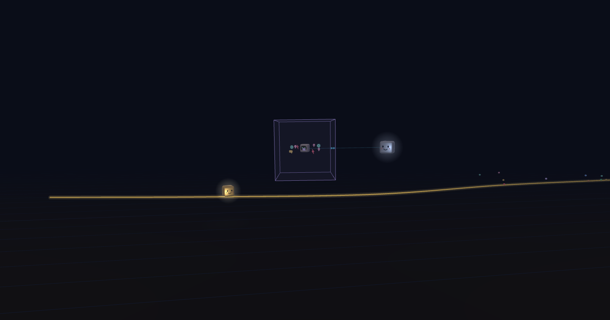

[Read in English](README.md)



# STL Studio, la interfaz entre tú y el modelo

https://github.com/user-attachments/assets/42374652-e20f-4214-9afe-68eb74a14ae9

STL Studio es una pequeña aplicación web local que se sienta entre tú y un modelo de IA y lo convierte en el director asistente de tu proyecto. Cuando se construye solo, o en un equipo pequeño, los proyectos rara vez mueren por falta de ideas: mueren por la atención dispersa. Diez chats abiertos, planes a medias, un «¿sigo?» perdido hace tres sesiones, y cada chat nuevo empezando de cero, pidiéndote con cortesía que le expliques todo otra vez.

El método STL lo resuelve con un solo canal. Todo lo que le dices al director (un comentario, una nota de voz, una pregunta, una decisión) entra al Studio. En cada revisión, que solo tú pides, el director lo lee todo, mantiene la ruta hacia tu meta y le da a cada persona una misión a la vez, con su porqué y un botón al lugar exacto. Tú decides; el director propone, ordena el trabajo y ejecuta solo lo que aprobaste, con pruebas y commits locales.

La memoria vive en el repositorio de tu propio proyecto, en una rama aparte, stl, así que nada depende del contexto de un chat: el modelo puede olvidar, el proyecto no. Menos pestañas, más cosas terminadas.

Versión 0.1.5. El repositorio es [ARGWABOT/STL-Sacred_Time_Line](https://github.com/ARGWABOT/STL-Sacred_Time_Line). La interfaz viene en español y en inglés.

## Empieza en tres pasos

1. **Baja STL Studio** ([la última versión](https://github.com/ARGWABOT/STL-Sacred_Time_Line/releases/latest)), descomprímelo y abre Claude Code en su carpeta.
2. **Pídele «inicializa STL Studio»**: instala todo y abre el Studio en tu navegador.
3. **Entrega tu proyecto** con «Entregar proyectos»: el director lo diagnostica y te da tu primera misión.

El detalle de cada paso está abajo, en «Instalar».

## Instalar

La instalación es la misma en cualquier computador. La forma más corta: baja el Studio, abre su carpeta con Claude Code y pídele **«inicializa STL Studio»**. El agente sigue [INSTALAR.md](INSTALAR.md) de principio a fin (en inglés, como todo lo que lee el modelo, [INSTALL.md](INSTALL.md)): revisa tu computador, te dice qué falta, te pide permiso antes de instalar cada cosa, enciende el Studio y lo abre en tu navegador. Tú solo dices «sí» y le das tu identidad de git. El paquete viene sin sus dependencias: el agente corre `npm install` al inicializarlo.

A mano:

```bash
git clone https://github.com/ARGWABOT/STL-Sacred_Time_Line.git stl-studio
cd stl-studio
npm run iniciar
```

`npm run iniciar` comprueba Node, git y tu identidad, instala las dependencias y, si no falta nada, enciende el Studio aparte y lo abre en **http://localhost:5180/** (es lo mismo que `npm run encender`). La primera vez, si este computador no tiene proyecto propio (aunque ya uses Claude Code con un modelo elegido), y siempre que le falten la transcripción o las voces, se abre el **asistente de instalación**, a pantalla completa, y mientras no lo termines «Entregar proyectos» te lleva a él: comprueba tu sesión de Claude Code (si falta, te guía y no deja seguir), pregunta tu plan de Claude, te deja marcado el modelo recomendado, y con «Dejar todo como viene» lo aceptas y ves en una lista lo que quedó (plan y modelo). No tiene pantalla de permisos: el director trabaja solo y, cuando necesita algo crítico, te pregunta con el aviso. Después instala la transcripción de tus notas de voz, que es obligatoria, con su avance, y te pide leer una frase para ver que entiende; si la descarga falla, dice si fue internet o espacio, y sin micrófono sigues igual. Después baja solas las voces que leen en voz alta, tres por idioma: son parte del Studio, sin casilla para saltarlas; si su descarga falla, ofrece «Reintentar», y la única forma de quitarlas es desinstalar el Studio. Al final, te invita a entregar tu primer proyecto o crear uno nuevo; STL Studio mismo espera en tu lista de proyectos, en cualquier sistema, para cuando quieras ajustarlo. Si lo cierras a mitad, vuelve donde quedó; lo repasas cuando quieras con «Repasar la instalación», en «Modelo y consumo», y «Verla como quien instala», a su lado, la muestra como la primera vez, sin guardar nada.

El Studio queda corriendo aunque cierres la terminal o el agente, y si su servidor se cae, se levanta solo. Después de reiniciar el computador, vuelve a correr `npm run encender` (si ya está encendido, solo lo abre; si lo que está encendido es otra copia del Studio, desde otra carpeta, la apaga y enciende esta: un solo Studio a la vez). En Windows, sin terminal: doble clic en **`Abrir STL Studio.cmd`**, en la carpeta del Studio, hace lo mismo (para tenerlo a mano: clic derecho › Enviar a › Escritorio).

### Lo que necesita

- **Node.js 24** o más nuevo y **git**, con tu identidad (`git config user.name` y `git config user.email`): si la carpeta del Studio no la tiene, una ventanita pide tu nombre y tu correo una vez, en cuanto abres el Studio, y los guarda en esa carpeta. Una carpeta de proyecto sin git, aunque esté vacía, recibe su repositorio (rama main) al entregarla.
- El Studio firma cada decisión tuya con esa identidad. Para cambiar tu correo después, corre `node tools/cambiar-correo.ts <correo nuevo>` en la carpeta del Studio: lo cambia en git y en cada proyecto a la vez.
- **Claude Code, con tu propia cuenta.** El Studio lanza el Claude Code que tú instalas y abres con tu cuenta; no ofrece el inicio de sesión de claude.ai, porque la documentación del SDK de agentes de Anthropic no deja que un producto de terceros lo ofrezca sin su aprobación.
- **Una pantalla ancha**: el Studio se usa en un computador con una pantalla de al menos 1350 píxeles de ancho (un portátil o más). Con menos, una cubierta te pide una pantalla más ancha; no hay versión para teléfonos ni tabletas.
- **Internet, para instalar.** Tu agente mira el disco antes de bajar nada, y el asistente dice cuánto ocupa lo que instala.

### Lo que se probó

- **El agente**: solo se promete Claude Code. Codex y Cursor están por probar.
- **El computador**: Windows 11 Pro, 64 GB de memoria, AMD Ryzen 7 5800X, donde el Studio se usa todos los días. Transcribir una nota tarda más o menos lo que dura. macOS y Linux están por probar, y también una instalación en un computador limpio.
- **La cuenta**: el plan Max 20x de Claude, con Opus 5.5 en esfuerzo «Alto», que en ese uso casi nunca acaba el límite de cada cinco horas ni el semanal. Con un plan menor, usa Sonnet 5.5 y un límite de tiempo más corto en «Modelo y consumo».
- **Lo que gasta una revisión**: una revisión corriente gasta cerca de 1 % del límite semanal de ese plan. Es aproximado, leído de lo que subió el límite en un día y medio de revisiones.

### Después de instalar

1. Inicia sesión una vez en la CLI de Claude Code (`claude auth login`): así «Pedir revisión» llama al director al instante, sin pantalla. La sesión del director, para lo demás, es Claude Code abierto **en la carpeta del Studio** (sin la CLI, deja corriendo ahí `/loop 5m /vigila`).
2. En el selector de proyecto (arriba de la barra lateral), oprime **«Entregar proyectos»** y elige su carpeta (si es una carpeta dentro de un repositorio, el Studio dice de cuál y ofrece entregar el repositorio entero o elegir otra carpeta) y, debajo, si quieres, «Cuéntame tu proyecto»: qué es, para quién es y a dónde lo quieres llevar, con tus palabras, escrito o grabado en el campo (en un proyecto nuevo es lo único que se pide; su nombre sale de su carpeta, legible, y lo cambias en «Proyecto»). Con texto en el campo, «Entregar y pedir su diagnóstico» le pregunta antes, a corta, al modelo que elegiste en «Modelo y consumo» si lo contado dice a dónde lo quieres llevar, y entrega al instante de todas formas: nunca se detiene a preguntar nada (qué es el proyecto lo deduce el modelo al leer la carpeta, y la meta se fija después del diagnóstico, en «Tu meta»); si tu texto nombró una meta, esa parte aparece en «Tu meta» marcada «Detectado»; si tarda más de 30 segundos, dice «Esto está tardando más de lo normal» y ofrece «Entregarlo sin comprobar»; si no se puede comprobar, o el campo está vacío, entrega sin más. Si lo escribiste en otro idioma que el de la interfaz, la misma comprobación lo traduce: «Qué es» y «Tu meta» reciben la traducción y tus palabras quedan en la memoria del proyecto; si no se puede traducir, se entrega igual y «Qué es» muestra tus palabras con «Se traducirá en la primera revisión». «Entregar y pedir su diagnóstico» pide esa revisión al instante, para un solo proyecto por cualquier camino (uno nuevo, una carpeta que escribes o uno elegido del escaneo, que busca en tu carpeta personal y en los lugares habituales de código, muestra en gris al final los que ya están en el Studio y, si no encuentra ninguno para entregar, abre ahí mismo el campo de la carpeta), que queda activo y empieza con la niebla de lectura apagada; mientras lo diagnostica, una pantalla de espera te enseña el Studio con 20 consejos ilustrados, que pasan solos y recorres con ‹ ›, hasta que el diagnóstico está listo; vuelve a abrirse en cualquier pestaña, también al abrir el Studio otra vez, mientras ese diagnóstico sigue en curso. Una barra fina arriba de las esperas y de «La meta» dice dónde va la entrega: Entregado · Diagnóstico («Planteamiento» en un proyecto nuevo) · Meta · Ruta · Primera misión. El director te propone dos metas: la más corta que ya deja algo valioso y la que mejor encaja.
3. En Proyecto › «La meta», cambia lo que quieras de una de las dos y oprime **«Confirmar la meta y trazar la ruta»**: pide la revisión que traza la ruta.
4. Tu primera misión es una lectura corta del diagnóstico; si al proyecto le falta algo para seguir desarrollándolo (su cuenta de GitHub o su repositorio, tu identidad de git), las que siguen lo completan, una corta cada una; después siguen las de trabajo. Hay un solo modo de permisos, sin nada que elegir: el director hace solo lo seguro y, para todo lo demás, pausa la revisión y te pregunta con un aviso hasta que respondas. Desde ahí, el ciclo: misión → marcar sus pasos (el último la entrega) → pedir revisión.

Cada «Explorar…» del Studio abre la ventana de carpetas de tu sistema: el Explorador de archivos en Windows, el Finder en macOS, y zenity o kdialog en Linux. Empieza en la carpeta que ya está escrita en el campo; si no hay, junto a tu último proyecto; y si no, en tu carpeta personal. Mientras está abierta, el formulario dice que puede estar detrás del navegador y ofrece «Usar el explorador del Studio». Un Linux sin zenity ni kdialog abre el explorador del Studio, y dice por qué solo la primera vez.

La primera vez, tu Studio ya llega con un proyecto, **STL Studio**, fijo al final de la lista: es tu propio Studio, con su diagnóstico hecho, y no tienes que cambiar nada. Para ajustarlo a tu forma de trabajar, selecciónalo y pídeselo al director en el Buzón. Antes de cada revisión de ese proyecto queda una rama de respaldo local; si un ajuste te deja sin Studio, vuelve a ella desde su carpeta:

```bash
git reset --hard respaldo/studio
```

### Actualizar

En la 0.1.5 todavía no hay de qué actualizar. Desde la 0.2.0, el Studio lo ofrece, con su informe de lo que choca con lo que cambiaste. Una línea al pie de la barra, junto a tu nombre, avisa si salió una versión nueva, con su enlace a las notas de esa versión en GitHub y una ✕ que la cierra hasta la siguiente: una vez al día el Studio le pregunta a GitHub cuál es la última, sin enviar nada tuyo ni de tus proyectos; se apaga con su casilla en «Modelo y consumo».

## Por qué

Dirigir un proyecto de semanas por chat tiene seis problemas: lo que envías se ejecuta al instante, corregir contamina el contexto, cada mensaje cuesta la conversación entera, no se puede comentar un párrafo, lo revisado vuelve a reescribirse y nadie decide qué sigue. STL los resuelve con un método y una interfaz:

| En el chat | En STL Studio |
| --- | --- |
| Envías y ya se está ejecutando | Tus comentarios esperan en el **Buzón**: los corriges o los borras antes de la revisión |
| Explicas a qué parte te refieres | **Comentas el párrafo, el paso o la decisión exacta** |
| Diez ideas, diez turnos | **Una revisión agrupada**: el director responde cada observación y dice qué hizo con ella |
| El modelo reescribe lo aprobado | **Siempre hacia adelante**: lo revisado queda sellado; lo que cambia llega en un documento nuevo |
| Trabajas en todo a la vez | **Una línea hasta la meta** y una misión a la vez, hacia la meta que fijaste |

El método completo está en [docs/metodo/metodologia.es.md](docs/metodo/metodologia.es.md), y en inglés, en [docs/metodo/metodologia.md](docs/metodo/metodologia.md). Al pie de la barra, **«Qué es STL»** abre la animación pública que lo explica en dos minutos.

## Qué trae

- **Entregar es elegir la carpeta**: el director lo diagnostica y te propone metas (un proyecto a la vez: por su carpeta, el que eliges con un clic en la lista que «Escanear el equipo» muestra en cuanto lo oprimes, o uno nuevo, del que escribe su planteamiento en su lugar). Si quieres, cuéntale dónde está el proyecto y a dónde quieres llevarlo, escrito o con «Grabar»: lo dicho se transcribe en tu computador y se suma al campo (el botón de entregar espera a que quede escrito), y el director establece la ruta desde ahí. El proyecto arranca en el idioma de tu interfaz. «Entregar y pedir su diagnóstico», su único botón, pide además la revisión en la que el director lo diagnostica (usa tu plan, como cualquier revisión): el diagnóstico es el primer paso de todo proyecto que entregas.
- **Hoy**, el inicio: se abre con un clic en la marca de arriba de la barra lateral. Muestra lo último que se completó, lo que sigue y tu misión de ahora, completa, paso a paso, cada paso con su botón al lugar exacto. Si entregaste todas, nunca queda vacío: dice tu paso siguiente (pedir la revisión, con su botón, o esperar la que ya corre). Lo entregado no vuelve atrás: un clic en una misión que espera al director despliega su resumen.
- **La orden de un paso, sin terminal**: un paso que trae una orden ofrece «Correr aquí», que la corre en el Studio, en la carpeta del proyecto, sin ventana, y deja bajo la orden una línea con su resultado y la salida entera plegada («Ver la salida entera»); si terminó bien, el paso se marca solo (con su comprobación, si la tiene). El paso muestra una acción a la vez: «Correr aquí» antes de correr, nada mientras corre, y «Ya lo hice» solo si terminó bien mientras estabas en otra misión (esa misión no vuelve sola); con la niebla de lectura puesta, la orden aparece cuando la niebla destapa su paso. La primera vez que aparece un tipo de acción, el paso dice qué va a correr y dónde, y pregunta «Hazlo ahora», «Hazlo ahora, y siempre en este proyecto» o «No»; «Siempre» va a «Permisos», la misma lista que usa el director, y una acción crítica (subir, publicar, desplegar) dice antes qué corre y desde qué carpeta de qué proyecto. Arriba, una línea cuenta las órdenes que corren en todo el Studio, cada una con su proyecto, con «Detener»; a los 10 minutos una orden no se corta: la línea ofrece «Darle 10 minutos más»; tras 3 minutos sin escribir nada, avisa que puede estar esperando una respuesta y ofrece «Me pide escribir: ábrela en una terminal», que la abre en una ventana y, desde entonces, abre ese tipo de orden directo en una en ese proyecto. Si falla: «Intentar de nuevo» o «Abrir la terminal con esta orden», y su nota de error, con la salida entera adjunta, ya está en el Buzón. Subir a la fuerza, reescribir la historia o leer un `.env` nunca corre desde un paso.
- **Atajos a tu aplicación**: en un proyecto web con su puerta local construida, un paso puede traer «Abrir <proyecto> como <rol> ↗», que abre esa página de tu aplicación en este computador ya con la sesión de ese rol, en una pestaña por proyecto, su pestaña de QA, donde la aplicación llena la ventana dentro de un marco (una aplicación que rehúsa los marcos se abre como antes, con un aviso), con un director flotante pequeño encima: «Tomar fotonota» congela la vista y empieza a grabar enseguida, para marcarla en rojo mientras hablas (con «Borrar los dibujos» para empezar las rayas de nuevo); cada vez que detienes, una foto con tus rayas se suma a la nota, «Añadir otro fragmento» sigue sobre la misma imagen y sus rayas, y «Enviar ya» le manda al director la voz (transcrita) con todas sus fotos, ligada a ese paso y a esa página; cada control de la grabación lleva su texto («Grabando» con su tiempo, «Detener y comprobar», «Añadir otro fragmento», «Quitar el audio»), cada foto queda como miniatura que se agranda, con una X redonda que la quita, y la foto grande se cierra con su X arriba a la derecha o con un clic fuera; la pestaña pide compartir la pantalla una sola vez por visita y la sigue compartiendo hasta que la cierras; la nota aparece sola en el Buzón abierto, y «Volver a mi misión» trae al frente la pestaña del Studio con la de QA aún abierta; se arrastra y se pliega; al cerrar la pestaña, la sesión termina, y si la aplicación no está corriendo el paso dice «Arranca <proyecto> primero» con la orden que la arranca. La puerta solo responde en este computador, con su archivo interruptor, y nunca guarda una cuenta ni una contraseña. Una fotonota llega al Buzón como «Falla». Bajo «Volver a mi misión», tres iconos (escritorio, tableta, teléfono) muestran tu aplicación en una pantalla de tableta de 820 × 1180 o de teléfono de 390 × 844, derecha, dentro de un contorno dibujado, achicada solo si no cabe en tu ventana; cada cambio recarga la página, nunca desde la caché del navegador (al abrir la pestaña tampoco, así que siempre ves la última versión), para que arranque en ese tamaño como lo haría en ese dispositivo (en el recorrido de STL, en la estación en que ibas); la pestaña recuerda el último dispositivo que elegiste en cada proyecto, el primer cambio dice en una línea que es el tamaño de la pantalla y no el navegador del dispositivo, una fotonota ahí toma la ventana entera y dice en qué dispositivo se tomó, y un paso que necesita una pantalla en particular puede abrir la pestaña de QA ya en esa vista, solo la primera vez que su botón la abre: después gana tu última elección. Un proyecto que no se abre en un navegador no tiene pestaña de QA: «Proyecto» lo dice una vez, bajo su carpeta, y el director no puede darle pasos que la abrirían.
- **El botón central del ratón, como un Enter**: en «Hoy», esté donde esté el cursor, abre primero «¿Dónde quedamos?» mientras tenga líneas por leer y, con todo leído, tu misión de ahora en modo enfoque; ahí, sin niebla por destapar, te lleva a donde pide su paso (el documento, la propuesta o el lugar), sin elegir nunca una opción por ti. Mientras corre un recorrido de ayuda, el botón central es su «Siguiente» hasta que termina. En cualquier otro lugar, oprime lo marcado como lo que sigue; y si no hay nada que destapar ni que oprimir, hace lo de la carita del director: te lleva a «Hoy» y a tu misión de ahora.
- **Una bienvenida corta y en silencio**: la primera vez que llegas a «Hoy» con una misión, una ventana pequeña de tres páginas presenta el botón central como el «siguiente» del Studio (pasa las páginas, igual que «→»; «Saltar» la cierra). Con «Modo ayuda» encendido, la primera vez que la niebla de lectura está puesta y cada vez que la enciendes con su nube, tres burbujas explican la niebla, ▶ y la voz junto a cada control, con «Saltar todo» (el botón central pasa a la burbuja siguiente, y la niebla de detrás no reacciona hasta que se cierran); con «Modo ayuda» apagado, nunca sale un globo de ayuda. Con «Modo ayuda» encendido, «Ver otra vez la introducción», arriba de la sección, la repite. Los globos de ayuda solo informan: ninguno trae un enlace.
- **Una sola pestaña para lo de afuera**: todo botón o enlace que lleva fuera del Studio abre la misma pestaña y la reusa, y las opciones de un paso nunca esperan a que abras su enlace.
- **Una revisión terminada, lista para leer**: en un proyecto que no es el Studio, la revisión se anuncia terminada cuando ya está lista la voz del primer párrafo de «¿Dónde quedamos?» y la del primer paso de tu misión, y la niebla de lectura si la tienes puesta, a lo más en 90 segundos; mientras, «Lo que va haciendo el director» deja a la vista la conversación entre el director y el modelo, con «Preparando la voz y la lectura de Dónde quedamos…» como su línea más nueva. Con la voz apagada no la espera, y una urgencia nunca espera.
- **Hoy y la ruta, una sola vista**: arriba, una línea desde «Hoy» hasta la bandera de tu meta, con cada pendiente como un punto en el orden del director: tus misiones en amarillo, lo que el director construye para ti en aguamarina y las propuestas que esperan tu respuesta en gris; no hay texto debajo de los puntos: al dejar el ratón sobre uno, un globo pequeño muestra al momento qué es, entero y dentro de la ventana: primero se ensancha y, si aún es muy largo, rueda con la rueda del ratón mientras el ratón siga sobre el punto o el globo; tu punto de ahora es más grande y late suave, y las misiones que ya entregaste en esta tanda quedan en la línea, marcadas, hasta la revisión, y un clic en una muestra lo que dijiste y elegiste en cada paso; nada más las lista bajo tu misión. Se ven doce puntos, las marcadas incluidas, y el resto se pliega en «y N más», y la bandera dice cuántos quedan. Un clic en un punto abre su tarjeta justo debajo de la línea: una misión con sus pasos, un pedido con lo que se pidió y lo que se hizo, una propuesta con «Aceptar» y «Descartar»; con todos los puntos hechos, la bandera es tu punto de ahora y su tarjeta ofrece «Meta cumplida» y «Fijar la siguiente meta». «Volver a mi misión» cierra la tarjeta. Ya no hay sección «Propuestas»: cada propuesta es un punto gris de la línea. En tu línea solo están tus misiones: el Studio está hecho para una persona que trabaja sola. Antes de que el proyecto tenga su meta, una línea corta muestra solo los pasos para fijarla, con la bandera vacía. La cabecera muestra tu meta bajo el nombre del proyecto, en letra pequeña, entera en su globo al dejar el ratón encima, con «Editar la meta» al lado: la cambias cuando quieras, sin firmarla, y al empezar su próxima revisión el director replantea hacia ella tus misiones en cola. Con todos los puntos hechos, la tarjeta de la bandera te pide confirmar «Meta cumplida» con lo que falte marcar de su lista a la vista; después, tu siguiente paso es «Editar la meta», y una vez guardada la tarjeta te ofrece «Pedir la revisión». Debajo de la línea, tu misión de ahora y tu ficha («Lo que sigue» ya no está: la línea es la cola); «Historia» muestra primero lo terminado, por mes (misiones aprobadas, pedidos hechos, propuestas ejecutadas), con la hoja de ruta a la meta plegada debajo. Ni la cuenta de la reserva ni los frentes están a la vista. Desde «¿Dónde quedamos?», «Ir a lo que sigue» con el botón central abre tu misión ya en modo enfoque.
- **Documentos comentables** por partes, con decisiones que se responden una a una, escritas o grabadas.
- **Los archivos clave de cada proyecto**: en «Documentos», dentro de «Documentación del proyecto», están los archivos que hay que conocer para entender el proyecto (los elige el director), con lo que es cada uno al pasar el ratón; y en «Proyecto», debajo de «Qué es», como una tabla corta de nombre y para qué sirve, que abre cada uno con un clic.
- **Los documentos que ya leíste, del más nuevo al más antiguo**: en «Documentos», los documentos leídos van del más reciente al más antiguo, así el último que leíste queda arriba; lo que viene después sigue en su orden de lectura.
- **«Proyecto», en pestañas**: la meta, qué es el proyecto, el diagnóstico del director y dónde está, cada uno en su pestaña; no hay pestaña «Equipo», porque el Studio es de una sola persona, y el director te escribe solo en el idioma que eliges con «ES · EN». Los nombres de las partes del proyecto, la meta, su lista y las líneas de los archivos clave se escriben solo en ese idioma mientras lo mantienes; si lo cambias, la revisión siguiente les agrega el otro idioma a todos de una vez (mientras tanto se muestran como se escribieron), y cuando editas uno (la meta, o una parte con su ✎ bajo «Las partes del proyecto», en la pestaña que dice qué es el proyecto), el director reescribe su otro idioma en la revisión siguiente. Las misiones y respuestas viejas quedan como se escribieron. Y el botón «Atrás» del navegador te devuelve a la sección, o a la pestaña, de donde venías.
- **Lo que detecta el diagnóstico**: al diagnosticar un proyecto, el director deja en «Proyecto» › «Qué es» el contexto y una meta que detectó, en tu idioma y marcados «Detectado»: en el campo vacío, o junto a tus palabras si contaste algunas, con «Usar esto» para tomarlo en un clic.
- **Buzón y preguntas**: los comentarios, los pedidos y las preguntas, en el Buzón; las respuestas a tus preguntas se leen además juntas, como un informe con conversaciones que puedes seguir, desde el filtro «Pregunta». Los números de sus pestañas y sus filtros cuentan solo lo que espera al director o tu decisión. Cada nota lleva su tipo, que eliges de un toque al dejarla (parte en «Auto (el modelo decide)», y lo cambias por ajuste, comentario, idea para después, algo falla o pregunta; la que dejas desde el ✉ de un lugar ya va marcada como comentario, y la tecla N abre y cierra ese diálogo), y hasta que el director la lea le cambias el tipo con ese mismo botón, en el Buzón. El Buzón se filtra por tipo y por cómo quedó; lo que quedó por decidir o aplazado pasa solo a integrada cuando lo resuelves en su lugar. Todo lo que le dices al director se escribe en un solo diálogo, que la tecla N abre sobre lo que estás mirando; si lo cierras sin enviar, queda como borrador en tu navegador, con lo que grabaste y adjuntaste, y «Pedir revisión» te lo recuerda antes; si guardar tarda demasiado, «Dejar de esperar» lo cierra y deja todo como borrador; al corregir una nota, solo cierra la ventana: el guardado sigue por detrás y lo que dijiste llega a esa nota, en su propio proyecto. Al volver, «¿Dónde quedamos?» trae lo que el director respondió a tus notas en pestañas por tipo y, en «La ruta», lo avanzado y sus comentarios; la barra de pestañas se ve siempre, aunque haya una sola, y cada línea que marcas como leída se desarma y sale de la lista, y se junta en «Ya leído», plegado, para que la lista solo muestre lo nuevo. Cambiar a un proyecto cuya revisión sigue en marcha no abre nada solo: ni «¿Dónde quedamos?» ni la misión en el modo enfoque, solo «Hoy» con la conversación de esa revisión entre el director y el modelo a la vista; lo nuevo se abre cuando la revisión termina.
- **Sin chat dentro del Studio**: todo lo que le dices al director llega al Buzón con «Comentario», el botón verde aguamarina de la columna del director; para conversar con el modelo, usa Claude Code o tu propio agente directamente. El color de acento del Studio es verde aguamarina, en el modo claro y en el oscuro, y el texto blanco sobre él lleva una sombra oscura suave para que se lea bien.
- **Pedir revisión**: un botón, y el Studio llama al director al instante. Mientras no pidas nada, ningún modelo corre. Cuando pedirla es lo único que te queda, el botón late suave en la cabecera. Cada revisión va en dos tiempos: primero, unos minutos con esfuerzo medio y sin tocar nada, el director la planea como una lista de encargos que el Studio comprueba; después la trabaja, encargo por encargo, y marca cada uno al terminarlo. Mientras tanto, «Lo que va haciendo el director» es una conversación en globos entre el director y el modelo: quién pide qué, cuánto tardó y quién espera a quién, con un reloj de ajedrez abajo que suma el tiempo y los tokens que informa Claude Code y, encima de él, la avalancha del contexto: en una montaña nevada que baja, el director va dentro de una bola de nieve que alcanza al modelo y lo apachurra (el modelo leyendo todo otra vez); el modelo forcejea y, al responder, la lanza lejos hacia atrás con un rebote, y la bola, un poco más grande cada vez, vuelve a perseguirlo, sin detenerse nunca, mientras avanza por la ladera con los encargos hechos; cerca del límite choca con un pino y se parte (el resumen), y lo que vino de la caché se ve como nieve apretada. En la revisión siguiente empieza otra vez pequeña. Terminada la revisión, «↻ Repetir la avalancha» la vuelve a mostrar, más rápida, con los tiempos guardados de esa revisión. Mientras corre la revisión es un panel de todo el alto entre la barra y el contenido, con los globos que suben desde los personajes de abajo, y un clic en la cara del director que trabaja lo abre y lo cierra, sin dejar ninguna franja a la vista; al cerrar la revisión, se va. Una revisión con una sola nota o una sola entrega va de una vez. Trabaja un director a la vez en cada proyecto: si otro está revisando, la tuya espera su turno, lo dice en la cabecera y empieza sola. Proyectos distintos se revisan a la vez: mientras uno corre, pides otro desde su proyecto; la cabecera lo dice en una línea (dos a la vez gastan tu plan más rápido), un punto junto a su nombre en la lista de proyectos muestra que corre y, al terminar, un aviso ofrece «Ir a <proyecto>». Para seguirlo, cambias a ese proyecto. Una actualización del Studio espera a que terminen todas las revisiones.
- **Detener y retomar**: la cabecera dice cuánto lleva el director trabajando y su límite en minutos. Con «Detener ahora» le pides que cierre con lo hecho; si en tres minutos no cerró, el Studio lo corta. Diez minutos antes de su límite el Studio le avisa que cierre: si al llegar sigue avanzando, le da diez minutos más, una sola vez. Si una revisión, una aclaración o lo urgente no se cierra, «¿Por qué?» dice qué pasó, y «Retomarla» la pide otra vez para que el director termine solo lo que faltó.
- **Una nota para el Studio desde cualquier proyecto**: con STL Studio registrado como uno de tus proyectos y otro proyecto abierto, «Nota para el Studio», al pie de la barra junto a «Qué es STL» (en el modo enfoque, justo encima de «Comentario»), deja una nota (escrita o grabada) en el Buzón del Studio mismo, con el proyecto desde donde la escribiste. No lanza nada: espera la revisión siguiente del Studio.
- **El trabajo del director detiene tus misiones y decisiones**: mientras una revisión planea o trabaja, o el director atiende una nota marcada urgente o aclara un paso, tus misiones y decisiones siguen a la vista, pero nada de lo que las hace avanzar se puede oprimir, y el servidor también lo rechaza (el ✉ y leer siguen abiertos), porque ese mismo trabajo puede cambiarlas. En una urgencia, el modo enfoque se apaga y una línea arriba de «Hoy» lo dice. Al terminar, esa línea dice cuántas de tus misiones cambiaron, con «Ver qué cambió»; si se detuvo antes, dice que tus misiones quedaron como estaban.
- **Un paso de afuera, comprobado**: si hiciste algo fuera del Studio (subir, configurar una cuenta), «Ya lo hice: compruébalo tú» marca el paso y el director lo comprueba al instante, aparte de la revisión; tú sigues con lo tuyo y, si no se cumplió, el paso te vuelve con lo que encontró.
- **Lo que gasta, en tu plan**: el Studio trabaja sobre tu cuenta, con Claude Code, nunca con una clave de API, y solo muestra uso: en «Modelo y consumo», las cifras de hoy y de la semana dicen los tokens y qué parte de tu semana de Claude gastaron, aproximada, sin ninguna cifra de dinero; si tu límite de cada cinco horas va casi lleno, te lo dice antes de pedirla. Los ayudantes del director trabajan con un modelo que consume menos de tu plan; con «Todo con el modelo que elegí», con el mismo que él. Junto al modelo elegido, lo que Anthropic dice de él, de una tabla del Studio con su fuente y su fecha, que avisa si el modelo no está en ella o si pasó de 60 días.
- **Su criterio, escrito y medido**: el director decide con un procedimiento propio ([docs/metodo/director/deciding.es.md](docs/metodo/director/deciding.es.md)), y «Modelo y consumo» › «Lo que gasta» muestra, por revisión, cómo salió lo que recomendó: lo que aprobaste tal cual o cambiaste, las misiones para rehacer, los «No lo entiendo», si cerró y sus tokens.
- **El historial de cada revisión, en la línea en grande**: la lupa de la línea de la barra la abre; un clic en una revisión muestra lo que planeó e hizo, lo que se le negó, los otros modelos que usó y para qué, y las urgencias y aclaraciones que le siguieron.
- **El director trabaja solo, y pregunta solo lo crítico**: corre cualquier orden (también pedidos a tu servidor local, aunque le manden datos), lee y edita donde trabaja sin preguntar; solo subir o traer, publicar o desplegar, deshacer cambios a la fuerza, borrar fuera de git, instalar un paquete con su nombre o escribir en un servidor de internet pausa la revisión y te pregunta con el aviso. Subir, traer y publicar se pueden dar «Siempre» solo para ese proyecto, y lo que nunca hace sigue fuera.
- **Un panel de permisos corto, que es un registro**: en «Modelo y consumo» › «Permisos», «Lo que autorizaste» lista lo que diste con «Siempre» en el aviso, una línea por permiso, lo más nuevo primero: dice con palabras sencillas lo que permite (ejecutar órdenes «git push», leer la carpeta «//c/x», toda la herramienta…), si es para este proyecto o para todos, cuándo y de qué revisión salió (la hora de la pregunta del aviso; si no fue durante una revisión, quién lo autorizó), y cada línea tiene su botón «Revocar». No hay nada que marcar por adelantado: cuando el director necesita algo crítico, pregunta con el aviso, y «Siempre» queda aquí; la lista vieja de lo que se le negó ya no está. Un campo «Filtrar» busca en el registro y se queda en su sitio en la pantalla mientras la lista de abajo cambia de alto. Los permisos generales están a la vista arriba; los específicos (una sola ruta, un archivo o una orden puntual) esperan plegados en «Permisos específicos», y el botón de una misión que te manda a revisar uno abre la lista ya filtrada a él. «Las skills de tus proyectos» lista solo las del proyecto activo, cada una con su casilla, que queda marcada una vez guardada.
- **Una cuenta de GitHub por proyecto**: en «Proyecto» › «Dónde está» escribes la cuenta aprobada para ese proyecto, o la llenas con «Usar la cuenta activa» (sin ninguna, el campo sugiere el dueño del repositorio en GitHub, «Detectada, sin guardar»); mientras guarda, su botón queda apagado y, después de medio segundo, muestra un círculo que gira (a los 30 segundos, «Sigue guardando… terminará solo»); si falla, una línea roja al lado dice por qué. Antes de subir, bajar o publicar, el Studio le pregunta a GitHub de quién es la sesión y, si no es esa o no hay ninguna, se detiene y te lo dice. Ahí mismo ves las sesiones que gh guardó en ese computador, de quién es cada una según GitHub y cuál está activa, y cambias de sesión o entras con otra cuenta sin la terminal. Al cambiar de proyecto, y al abrir el Studio, la sesión activa de gh pasa sola a la cuenta aprobada de ese proyecto si gh la tiene guardada; si no, un aviso te lo dice. Cada revisión lleva la llave de la cuenta de su proyecto (su token de gh, solo para esa revisión), así que dos revisiones de proyectos con cuentas distintas suben y bajan a la vez sin tocar la sesión activa de gh; solo si gh no tiene guardada esa cuenta se le niegan los pasos de red, y la revisión dice por qué. El Studio mira cada minuto la sesión activa de gh y te avisa cuando cambia o no es la cuenta aprobada del proyecto abierto.
- **Las skills de tus proyectos, solo con tu permiso**: el director no carga ninguna skill ni ningún comando que traiga un proyecto (su carpeta `.claude`) hasta que lo autorices en «Modelo y consumo» › «Permisos», donde ves antes lo que el Studio encontró en cada uno; si un archivo suyo cambia, deja de cargarlo hasta que lo autorices otra vez.
- **Varios proyectos**, uno activo a la vez: al cambiar, el director te dice dónde quedaron.
- **Español e inglés**: ES y EN, junto a tu nombre al pie de la barra, cambian el idioma de un toque y queda guardado en tu computador. Cada documento se lee en voz alta con la voz de su idioma, sea cual sea el de la interfaz.
- **Voz**: graba tus notas; se transcriben en tu computador, sin servicios externos, en el idioma en que hables (lo detecta solo), con el modelo de voz cargado mientras el Studio está encendido, para no cargarlo en cada nota (ocupa cerca de 1 GB de memoria; en un computador con menos de 15 GB se libera tras 10 minutos sin grabar, la grabación lo dice mientras vuelve a cargarse y «Modelo y consumo» dice qué regla sigue este computador); el director te responde siempre en el idioma de tu interfaz. Un audio que no se pudo transcribir no se borra: queda en cola y se vuelve a intentar solo.

## La línea viva

Toda la barra lateral es una galaxia, en los dos temas. En su espacio libre, a todo su ancho, **la línea viva del proyecto** ondula todo el tiempo, y sobre ella vas tú, el cubito con carita, al centro: la línea se corre hacia la izquierda, despacio con el reloj y un paso con cada cosa que le dejas al director. Cada cosa nace de ti, en una rama de su tipo y su color (un comentario, un ajuste, una idea, una falla, una pregunta, lo que eliges o decides, una entrega): su base se queda donde nació, sube o baja hasta su altura y su cabeza te sigue en paralelo; al pasar el ratón por la cabeza se abre un globo con la nota que la hizo nacer, y la línea se queda quieta mientras lo lees (las ramas ya juntadas en revisiones pasadas no abren ninguno).

Al pedir la revisión aparece el director en ese punto y tú das un salto adelante, aparte de él, porque puedes seguir: lo que dejas mientras revisa nace de ti y espera la revisión siguiente. Mientras revisa avanzas más lento y los dos comparten el centro. Junta las ramas que nacieron antes, sus cabecitas giran a su alrededor mientras trabaja, y un clic en él abre lo que va haciendo. Al cerrar, el punto queda marcado, con esas ramas juntándose ahí (su historia se guarda en la memoria del proyecto, así que tu equipo ve la misma), y tu lote de misiones se reparte adelante, en la línea: al entregar cada una, llegas a ella.

En la barra se arrastra de lado para mirar el pasado de la línea; al soltarla, dos segundos después vuelve a ti a paso parejo. En ese pasado, la rama de lo que quedó para una fase que aún no llega se ve tenue, con su trazo cortado, hasta su turno. En el modo enfoque va pegada al pie de la ventana, con más tiempo a la vista, sobre el mismo cielo. Sus estrellas avanzan siempre, y más rápido cuando avanzas (con «menos movimiento», quietas); con muchas ramas crece hacia arriba antes de apilar sus cabecitas. Su botón «Ocultar la línea», abajo a la derecha sobre el dibujo, la quita y la ventana toma su espacio.

En la barra, una lupa tenue en su esquina derecha, siempre a la vista, abre **la línea en grande**: una ventana del 90 % de la pantalla con la misma línea y toda su historia, sus ramas y los trazos que se juntan en cada revisión, con la carita del director en cada una, en rojo las que no cerraron. Las líneas ocupan cerca del 30 % del alto, con el cielo a la vista y varias revisiones a la vez. Se arrastra o se mueve con la rueda y no vuelve sola: un botón en su esquina la lleva de regreso al punto de ahora. Al pasar sobre una revisión un globo dice su fecha y su hora y su informe (cuántas ramas abriste, cuántas juntó el director en la línea, cuántas esperan su fase y cuántas cerró; el mismo globo se abre sobre cada revisión en la barra lateral), y un clic abre a la derecha su historial, en dos pestañas: «Resumen», con lo que planeó, lo que hizo, sus tokens y su parte aproximada del plan, y «Conversación», que abre donde terminó la revisión, mientras exista su registro. Cada revisión se consulta ahí.

## Cómo funciona

```
 Tú ──▶ STL Studio (http://localhost:5180) ──▶ memoria del proyecto ◀── sesión del director (Claude Code)
        comentas, entregas, decides             en SU repositorio:          «Pedir revisión» o «revisa estudio»
                                                rama stl, carpeta .stl/
```

El Studio no guarda datos de tus proyectos: la memoria de cada uno (su plan, su buzón, sus decisiones, los documentos del director) vive en **su propio repositorio**, en una rama aparte (`stl`) que el Studio abre en la carpeta `.stl/`. No se mezcla con tu código ni hace correr tu integración continua, y sube a la nube del proyecto solo si tú lo pides. El director es una sesión de Claude Code abierta en la carpeta del Studio: cuando pides la revisión (o le escribes **«revisa estudio»**), lee todo lo pendiente, responde, ajusta la ruta y deja tu misión siguiente. Sus reglas están en [CLAUDE.md](CLAUDE.md) (y en [AGENTS.md](AGENTS.md) para otros agentes). El diseño de la interfaz y sus razones: [docs/metodo/diseno-studio.es.md](docs/metodo/diseno-studio.es.md).

## Comentarios y preguntas, sin salir de lo que haces

Junto a la cara del director (abajo a la derecha) hay atajos para decirle algo (y, en un documento o en tu misión de ahora, el del modo enfoque; la revisión se pide arriba, en la cabecera):

- **Comentario**: una idea o algo que quieres que tenga en cuenta. No entra de golpe al proyecto: el director decide cómo y dónde administrarlo (una misión, una propuesta, un documento o la ruta) y te responde en el Buzón. Si luego cambias de idea con otra nota, la anterior queda marcada «Reemplazado» en el Buzón, y lo marca el director al responder.
- **Preguntas**: una pregunta también es una nota: la dejas con «Comentario» y el tipo «Pregunta», y el director la responde en la próxima revisión. El Buzón las muestra con el filtro «Pregunta».
- **Algo del Studio mismo**, mientras diriges otro proyecto: cambia al proyecto del Studio y déjalo con «Comentario»; espera, sin lanzar nada, la próxima revisión del proyecto del Studio.

Mientras grabas, el diálogo se hace a un lado: puedes leer y moverte por el Studio mientras hablas.

Cada palabra clave de STL en la interfaz (misión, reserva, criterio, frente, sello, propuesta, pedido, revisión y Buzón) lleva un pequeño **«?»**, siempre puesto: pasa el ratón y te la explica en una línea; con un clic queda abierto (otro clic, un clic fuera o Esc lo cierran).

Ninguna ayuda sale sola: los recorridos guiados se ven solo cuando enciendes el **modo ayuda**, con su círculo y su «?» dentro de un globo entre los del director abajo a la derecha (siempre a la vista, también en el modo enfoque, y encima de cualquier recorrido). Mientras está encendido, su fondo es rojo y su «?» se ve entero; apagado, el «?» va tachado. Con él encendido, la primera vez que abres **Hoy** con una misión, el Studio te ofrece una ayuda guiada de cinco globos, uno a la vez (tu misión, los botones de cada paso, «Lo que sigue», el ✉ y «Pedir revisión»), con «Siguiente», «Saltar la ayuda» o Esc; no se repite en tus otros proyectos. El **Buzón** y los **documentos** traen la suya, de cuatro globos cada una, la primera vez que los abres con algo que explicar; igual **La ruta** (cuatro globos) y **Modelo y consumo** (tres). El modo ayuda también explica cada parte al pasar el ratón y trae «Ver otra vez el recorrido de esta sección»; el mismo botón lo apaga y cierra un recorrido a medias. El globo propio del Studio sobre un botón o una palabra sale solo cuando el ratón se queda dos segundos quieto encima, por encima de cualquier ventana abierta.

Con la **niebla de lectura** (la nube junto a la cara del director), lo que escribió el director queda bajo niebla y lo vas destapando con él, arrastrándolo o con ▶. La tarjeta de tu misión se destapa de una vez, su porqué y su paso con un solo ▶. Lo que recorres queda anotado para ti en este computador, fuera de git y sin olvido: al volver días después, sigue destapado. Nada de lo que pasa en segundo plano interrumpe lo que se lee, ni en la pantalla ni en el audio: lo que llega se pinta al quedar libre. «Volver a nublar», en la franja de la niebla, cubre otra vez lo de esa pantalla para releerlo despacio, sin borrar lo recorrido.

## Notas de voz

Son parte del método, y escribir es solo el respaldo: la transcripción es obligatoria. Se graban en el Studio y se transcriben **en cuanto terminas de grabar**, en tu computador, con faster-whisper: nada sale de tu equipo. No se pueden grabar silencios: si en los primeros 8 segundos no llega sonido, la grabadora se detiene sola, descarta lo vacío y te lo dice, para que mires tu micrófono. Después, las pausas no cuentan: lo que ya tiene sonido nunca se pierde. Mientras tanto ves «Transcribiendo…»; cuando está lista, lo que se entendió aparece donde grabaste y en el Buzón, y lo puedes corregir. Mientras el director no la lee, «Corregir» también deja completarla hablando o rehacer una parte: márcala antes de grabar y lo que digas la reemplaza. Con el texto escrito, el audio se borra: nunca entra a git ni sale de tu computador (si la transcripción falla, se queda hasta que salga bien, o hasta que escribas tú lo que dijiste).

La instala el asistente de instalación, en cualquier sistema y sin WSL. A mano, desde la carpeta del Studio (en Windows, en Git Bash):

```bash
bash tools/entorno/instalar_transcripcion.sh
```

Si falta uv (el gestor de Python de Astral, gratuito), lo instala. Es la misma instalación en cualquier computador: transcribe en el procesador, y una nota tarda más o menos lo que dura. Las voces que leen en voz alta se instalan igual, con `bash tools/entorno/instalar_voces.sh`; con la voz encendida, desde que sale el reporte de una revisión el Studio prepara en segundo plano la voz de lo que vas a leer y la guarda en el computador, hasta 1 GB (al pasarlo, sale el audio más viejo), para que pasar de una a otra no espere. El Studio no usa WSL para nada. Mientras no esté instalada, el Studio lo dice con esta orden, y la bitácora de «Modelo y consumo» anota cada nota que transcribe (sus líneas nuevas se escriben en el idioma de la interfaz).

## La memoria de cada proyecto, respaldada

El Studio es de una sola persona, en su computador. Cada decisión es un commit local en la memoria del proyecto (su rama `stl`), y nunca se trae nada de GitHub. Al terminar cada revisión de un proyecto, su memoria sube sola a la rama `stl` del repositorio de ese proyecto en GitHub, sin forzar nada, solo si ese repositorio es privado y el Studio tiene el permiso de subir en ese proyecto (dado con «Siempre» en el aviso, y listado en «Modelo y consumo» › «Permisos»). El pie de la barra izquierda dice cuándo subió el último respaldo; un clic abre una ventanita con a dónde fue y «Respaldar ahora». Sin repositorio en GitHub o sin ese permiso dice «Sin respaldo», y un clic lleva a donde se conecta; si un respaldo falla, dice «El respaldo falló», y un clic da el motivo y cómo arreglarlo. Para respaldar aun así en un repositorio público, enciende «Respaldar en un repositorio público» en «Proyecto» › «Dónde está», con su aviso a la vista. La memoria del mismo Studio nunca se respalda en el repositorio del Studio, que es público: va solo a un repositorio privado suyo, en la cuenta de GitHub aprobada del proyecto, cuya dirección pegas en «Proyecto» › «Dónde está».

## Comandos

| Comando | Para qué |
| --- | --- |
| `npm run encender` | Enciende el Studio aparte (se levanta solo si se cae) y lo abre; `-- --estado` dice si está encendido y `-- --apagar` lo apaga. Si aun así el servidor se detiene, la página abierta muestra un aviso fijo (cerrar la pestaña y abrir con doble clic «Abrir STL Studio.cmd») hasta que vuelve, y después «Dónde quedamos» cuenta una vez cuándo se cayó y sus causas probables. Si la página misma no carga, una pantalla de emergencia dice qué falló, en el último idioma que usaste, y guarda el error en este computador (`.estudio/fallas.json`, 90 días); su «Volver a la versión que funcionaba» muestra la última versión que cargó al cerrar una revisión y, si confirmas, devuelve a ella el código del Studio con un commit nuevo, sin el modelo y sin tocar la memoria de tus proyectos (lo que no tenía commit va antes a una rama `respaldo/…`). Mientras está encendido, un chequeo de salud corre al encender y cada 5 minutos, sin el modelo: el plan, las marcas de los pasos, una revisión atascada «en marcha», el candado del director, la rama `stl`, Claude Code con sesión y al menos 2 GB libres en el disco. Lo seguro lo arregla solo y lo anota; «Modelo y consumo» › «Salud del Studio» muestra cada arreglo de los últimos 7 días, y lo que no puede arreglar sale como un aviso fino arriba de cada sección. La misma sección cuenta las fallas de los últimos 90 días por causa (el modelo, el código del Studio, el computador o la cuenta, que pone el código sin el modelo; cuentan también las revisiones que no cerraron, no las fallas forzadas para probar). «Diagnosticar y reparar», ahí y en la pantalla de emergencia, lanza al director solo con tu clic para reparar el código del Studio (30 minutos, sin subir nada, esperando a que cierre una revisión en marcha): un intento por clic, su arreglo en su propio commit, deshecho si no pasan sus tipos o sus pruebas, y el Studio se reinicia si pasan; una línea dice qué hace, y otra avisa cuando tu límite de cinco horas pasa del 90 %. Tras dos fallas seguidas con la misma causa, el aviso de arriba la ofrece |
| `npm run estudio` | Abre el Studio en esta terminal (muere con ella; útil para desarrollar el Studio) |
| `npm run bandeja` | La revisión del director (la corre la sesión del director) |
| `npm run diagnosticar` | La radiografía del repositorio del proyecto activo |
| `npm run estado -- <frente o rutas>` | Antes de una tarea en un proyecto: ¿está en foco o en espera? |
| `node tools/iniciar.ts --diagnostico` | Qué falta en este computador, sin instalar nada |
| `node tools/quitar-proyecto.ts <id> [--confirmo]` | Lo mismo que «Quitarlo de este Studio», al final de «Proyecto» › «Dónde está»: sin `--confirmo` dice todo lo que se borraría; con él, borra toda la memoria del proyecto, sin archivo (su carpeta `.stl`, su rama `stl`, las líneas de STL de su CLAUDE.md o AGENTS.md en un commit local y, con el permiso de subir y su cuenta aprobada, su copia en GitHub) y todo lo suyo en este Studio; no toca su código ni sus otras ramas, y STL Studio mismo no se puede quitar |
| `… --proyecto <id>` | Cualquiera de las herramientas, sobre otro proyecto que el activo |
| `npm test` y `npm run typecheck` | Pruebas y tipos del Studio |

## Estructura

| Carpeta | Qué hay |
| --- | --- |
| `estudio/src/` | La interfaz: una sola página |
| `estudio/servidor/` | El servidor local (un plugin de Vite): lee y escribe el estado y firma cada decisión con tu identidad de git |
| `src/director/` | La lógica pura del método: fases, puertas, criterios, misiones, sellos y esfuerzo |
| `tools/director/` | Las herramientas del director: la bandeja, la radiografía, el estado y la transcripción |
| `plantilla/` | De donde nace la memoria de cada proyecto |
| `docs/metodo/` | La metodología, el diseño del Studio y su evaluación |

## Contribuir

STL Studio lo cambia solo su autor: no acepta cambios de código de otros (pull requests). Los avisos de fallas, sí: abre un issue con el formulario «Algo falla», que pregunta tu sistema, la versión del Studio, qué hiciste y qué pasó. Y si lo probaste, el formulario «Lo logré / Me trabé en…» cuenta si tu primer proyecto llegó a su diagnóstico. Tu propia copia la puedes cambiar cuanto quieras. Ver [CONTRIBUTING.es.md](CONTRIBUTING.es.md).

## Créditos

El método STL fue creado por ARGWABOT (A Regular Guy With A Bunch Of Tokens). STL Studio, la interfaz entre tú y el modelo, es su aplicación base, con licencia [PolyForm Shield 1.0.0](LICENSE): se usa gratis, también en proyectos comerciales, y se cambia para el uso propio; lo que no permite es ofrecer un producto que compita con STL Studio, como venderlo o publicarlo de nuevo con otro nombre.

## Por qué fue privado

Este repositorio fue privado mientras se probaba. Antes de abrirlo se comprobaron tres cosas:

- el Studio funcionando en el computador con Windows 11 donde se usa cada día;
- la medición del núcleo del director;
- una historia publicada sin datos de ningún proyecto.

## Una nota sobre macOS

STL Studio se construyó y se probó en Windows. Está escrito para funcionar también en un Mac (corre sus órdenes con bash y abre Terminal donde Windows abre Git Bash), pero nadie lo ha probado todavía en un Mac: si algo falla ahí, abre un issue con el formulario «Algo falla» y di que fue en un Mac.
