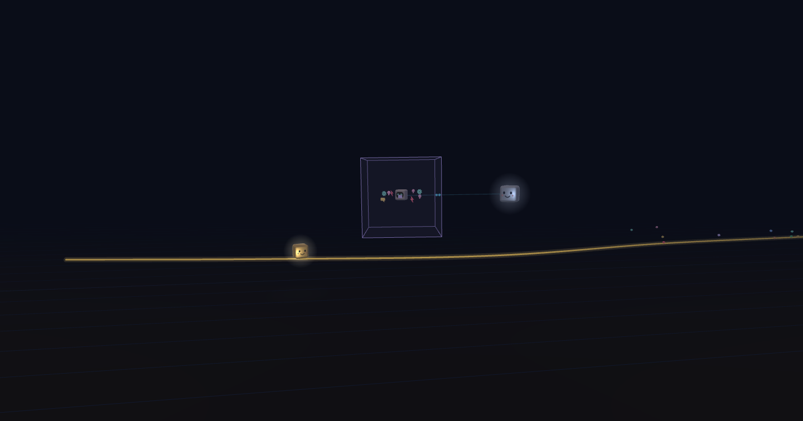

[Leer en español](README.es.md)



# STL Studio, the interface between you and the model

https://github.com/user-attachments/assets/2accc981-a2a1-466c-85df-c4b9feb5aa39

STL Studio is a small local web app that sits between you and an AI model and turns the model into your project's assistant director. Building alone, or in a small team, projects rarely die from a lack of ideas: they die from scattered attention. Ten chats open, half-finished plans, a «shall I proceed?» lost three sessions ago, and every new chat starting from zero, politely asking you to explain everything again.

The STL method fixes that with a single channel. Everything you tell the director (a comment, a voice note, a question, a decision) goes into the Studio. On each review, which only you request, the director reads it all, keeps the roadmap toward your goal and gives each person one mission at a time, with its why and a button to the exact place. You decide; the director proposes, orders the work and executes only what you approved, with tests and local commits.

The memory lives in your project's own repository, on a separate stl branch, so nothing depends on a chat's context: the model can forget, the project can't. Fewer tabs, more finished things.

Version 0.1.1. The repository is [ARGWABOT/STL-Sacred_Time_Line](https://github.com/ARGWABOT/STL-Sacred_Time_Line). The interface comes in English and Spanish.

## Start in three steps

1. **Download STL Studio** ([the latest version](https://github.com/ARGWABOT/STL-Sacred_Time_Line/releases/latest)), unzip it and open Claude Code in its folder.
2. **Ask it «initialize STL Studio»**: it installs everything and opens the Studio in your browser.
3. **Hand over your project** with «Hand over projects»: the director diagnoses it and gives you your first mission. A folder without git, even an empty one, gets its own repository from the Studio.

The details of each step are below, in «Install».

## Install

The installation is the same on any computer. The shortest way: download the Studio, open its folder with Claude Code and ask it to **«initialize STL Studio»**. The agent follows [INSTALL.md](INSTALL.md) from start to finish (in Spanish, [INSTALAR.md](INSTALAR.md)): it checks your computer, tells you what is missing, asks permission before installing each thing, turns the Studio on and opens it in your browser. You only say «yes» and give it your git identity. The package comes without its dependencies: the agent runs `npm install` when it initializes it.

By hand:

```bash
git clone https://github.com/ARGWABOT/STL-Sacred_Time_Line.git stl-studio
cd stl-studio
npm run iniciar
```

`npm run iniciar` checks Node, git and your identity, installs the dependencies and, if nothing is missing, turns the Studio on apart and opens it at **http://localhost:5180/** (the same as `npm run encender`). The first time, if this computer has no project of its own (even if you already use Claude Code with a model chosen), and whenever the transcription or the voices are missing on it, the full-screen **installation assistant** opens, and until it is finished «Hand over projects» leads back to it: it checks your Claude Code session (if it is missing, it guides you and does not let you go on), asks for your Claude plan, leaves the recommended model checked, and with «Leave everything as it comes» you accept it and see in a list what was left (plan and model). It has no permissions screen: the director works on its own and, when it needs something critical, it asks you with the banner. Then it installs the transcription of your voice notes, which is required, with its progress, and asks you to read a sentence to see that it understands; if the download fails, it says whether it was the internet or the space, and without a microphone you go on all the same. Then it downloads the voices that read aloud by itself, three per language: they are part of the Studio, with no checkbox to skip them; if the download fails, it offers «Retry», and the only way to remove them is to uninstall the Studio. At the end, it invites you to hand over your first project or create a new one; STL Studio itself waits in your project list, on any system, for when you want to adjust it. If you close it halfway, it comes back where it was; you go over it whenever you want with «Review the installation», in «Model & usage», and «See it as a new user does», next to it, shows it as the first time, without saving anything.

The Studio keeps running even if you close the terminal or the agent, and if its server falls it comes back up by itself. After restarting the computer, run `npm run encender` again (if it is already on, it only opens it; if what is on is another copy of the Studio, from another folder, it turns that one off and turns this one on: a single Studio at a time). On Windows, without a terminal: double-click **`Abrir STL Studio.cmd`**, in the Studio's folder, which does the same (to keep it at hand: right click › Send to › Desktop).

### What it needs

- **Node.js 24** or newer and **git**, with your identity (`git config user.name` and `git config user.email`): if the Studio's folder has neither, a small window asks for both once, as soon as the Studio opens, and saves them in that folder.
- The Studio signs each of your decisions with that identity. To change your email later, run `node tools/cambiar-correo.ts <new email>` in the Studio's folder: it changes it in git and in each project at once.
- **Claude Code, with your own account.** The Studio launches the Claude Code you install and sign in to yourself; it does not offer the claude.ai sign-in, because Anthropic's documentation for its agent SDK does not let a third-party product offer it without their approval.
- **A wide screen**: the Studio is used on a computer with a screen at least 1350 pixels wide (a laptop or more). With less, a cover asks for a wider screen; there is no version for phones or tablets.
- **Internet, to install.** Your agent checks the disk before downloading anything, and the assistant says how much what it installs takes.

### What was tested

- **The agent**: only Claude Code is promised. Codex and Cursor are still to be tested.
- **The computer**: Windows 11 Pro, 64 GB of memory, AMD Ryzen 7 5800X, where the Studio is used every day. A note takes about as long to transcribe as it lasts. macOS and Linux are still to be tested, and so is an installation on a clean computer.
- **The account**: Claude's Max 20x plan, with Opus 5.5 at «High» effort, which in that use almost never reaches the five-hour limit or the weekly one. With a smaller plan, use Sonnet 5.5 and a shorter time limit in «Model & usage».
- **What a review uses**: an ordinary review uses about 1 % of the weekly limit of that plan. It is approximate, read from what the limit rose over a day and a half of reviews.

### After installing

1. Sign in once to the Claude Code CLI (`claude auth login`): that way «Request review» calls the director at once, without a screen. The director's session, for everything else, is Claude Code open **in the Studio's folder** (without the CLI, leave `/loop 5m /vigila` running there).
2. In the project selector (at the top of the sidebar), press **«Hand over projects»** and choose its folder (if it is a folder inside a repository, the Studio says which one and offers to hand over the whole repository or choose another folder) and, below it, if you like, «Tell me about your project»: what it is, who it is for and where you want to take it, in your own words, written or recorded into the field (for a new project it is the only thing asked; the project's name comes from its folder, made readable, and you can change it in «Project»). With text in the field, «Deliver and request its diagnosis» first asks, briefly, the model you chose in «Model and usage» whether what you wrote says what the project is and where you want to take it: if it says both, it hands over at once, and the goal part shows in «Your goal» marked «Detected»; if the goal is missing, one question appears under the field («Where do you want to take it?»; what the project is is never asked: the model works it out by reading the folder) with a short suggestion of what to add and an example (a few words such as «booking for dentists» already say what it is), a small answer field and «One or two sentences are enough», and the second press hands it over at once, without checking again; if it takes more than 30 seconds, it says «This is taking longer than usual» and offers «Hand it over without checking»; if the check cannot run, or the field is empty, it just hands over. If you wrote it in a language other than the interface's, the same check translates it: «What it is» and «Your goal» get the translation and your own words stay in the project's memory; if it cannot be translated, it is handed over anyway and «What it is» shows your words with «They will be translated in the first review». «Deliver and request its diagnosis» requests that review at once, for a single project by any path (a new one, a folder you write or one picked from the scan, which looks in your user folder and the usual places for code, shows the projects already in the Studio greyed out at the end and, if it finds none to hand over, opens the folder field right there), which becomes the active one and starts with the reading fog off; while it is diagnosed, a waiting screen teaches you the Studio with 20 illustrated tips, which turn on their own and you browse with ‹ ›, until the diagnosis is ready; it opens again in any tab, also after reopening the Studio, while that diagnosis is under way. A thin bar at the top of the waiting screens and of «The goal» shows where the handover is: Handed over · Diagnosis («Approach» for a new project) · Goal · Route · First mission. The director proposes two goals: the shortest valuable one and the best fit.
3. In Project › «The goal», change what you want in one of the two and press **«Confirm the goal and draw the route»**: it requests the review that draws the roadmap.
4. Your first mission is a short reading of the diagnosis; if the project lacks something to keep developing it (its GitHub account or repository, your git identity), the next ones complete it, one short mission each; the work missions follow. There is one permission mode, with nothing to choose: the director does by itself what is safe and, for anything else, pauses the review and asks you with a banner until you answer. From there, the cycle: mission → mark its steps (the last one delivers it) → request review.

The first time, your Studio already comes with one project, **STL Studio**, fixed at the end of the list: it is your own Studio, with its diagnosis done, and you do not have to change anything. To adjust it to your way of working, select it and ask the director in the Inbox. Before each review of that project a local backup branch is left; if an adjustment leaves you without a Studio, go back to it from its folder:

```bash
git reset --hard respaldo/studio
```

### Updating

In 0.1.1 there is nothing to update from yet. From 0.2.0 on, the Studio offers it, with its report of what clashes with what you changed. A line at the foot of the sidebar, next to your name, says when there is a new version, with its link to its notes on GitHub and an ✕ that closes it until the next one: once a day the Studio asks GitHub which is the latest, without sending anything of yours or of your projects; it is turned off with its checkbox in «Model & usage».

## Why

Directing a weeks-long project by chat has six problems: what you send runs at once, correcting pollutes the context, every message costs the whole conversation, you cannot comment on a paragraph, what was reviewed gets rewritten and nobody decides what comes next. STL solves them with a method and an interface:

| In the chat | In STL Studio |
| --- | --- |
| You send and it is already running | Your comments wait in the **Inbox**: you correct or delete them before the review |
| You explain which part you mean | **You comment on the exact paragraph, step or decision** |
| Ten ideas, ten turns | **One grouped review**: the director answers each remark and says what it did with it |
| The model rewrites what was approved | **Always forward**: what was reviewed stays sealed; what changes arrives in a new document |
| You work on everything at once | **A roadmap with gates** and one mission at a time, toward the goal you set |

The full method is in [docs/metodo/metodologia.md](docs/metodo/metodologia.md), and in Spanish, in [docs/metodo/metodologia.es.md](docs/metodo/metodologia.es.md). At the foot of the sidebar, **«What is STL»** opens the public animation that explains it in two minutes.

## What it brings

- **Handing over is choosing the folder**: the director diagnoses it and proposes goals (one project at a time: by its folder, the one you click in the list that «Scan this computer» shows as soon as you press it, or a new one, for which it writes its approach instead). If you like, tell it where the project is and where you want to take it, written or with «Record»: what you say is transcribed on your computer and added to the field (the delivery button waits until it is written), and the director sets the route from it. The project starts in the language of your interface. «Deliver and request its diagnosis», its only button, also requests the review in which the director diagnoses it (it uses your plan, like any review): the diagnosis is the first step of every project you hand over.
- **Today**, the start: it opens with a click on the mark at the top of the sidebar. It shows what was last completed, what comes next and your current mission, whole, step by step, each step with its button to the exact place. If you delivered them all, it is never empty: it says your next step (requesting the review, with its button, or waiting for the one already running). What was delivered does not go back: a click on a mission waiting for the director unfolds its summary.
- **A step's command, without a terminal**: a step that brings a command offers «Run here», which runs it in the Studio, in the project's folder, with no window, and leaves a line under the command with its result and the whole output folded («See the whole output»); if it finished well, the step marks itself (with its check, if it has one). The step shows one action at a time: «Run here» before running, nothing while it runs, and «Done» only if it ended well while you were on another mission (that mission does not come back by itself); with the reading fog on, the command shows when the fog uncovers its step. The first time a kind of action comes up, the step says what it will run and where, and asks «Do it now», «Do it now, and always in this project» or «No»; «Always» goes to «Permissions», the same list the director uses, and a critical action (pushing, publishing, deploying) says first what it runs and from which folder of which project. At the top, one line counts the commands running in the whole Studio, each with its project, with «Stop»; at 10 minutes a command is not cut: the line offers «Give it 10 more minutes»; after 3 minutes without writing anything, it warns that it may be waiting for an answer and offers «It asks me to type: open it in a terminal», which opens it in a window and, from then on, opens that kind of command straight in one in that project. If it fails: «Try again» or «Open the terminal with this command», and its error note, with the whole output attached, is already in the Inbox. Force-pushing, rewriting history or reading a `.env` never runs from a step.
- **Shortcuts into your app**: in a web project whose local door is built, a step can bring «Open <project> as <role> ↗», which opens that page of your app on this computer already signed in as that role, in one tab per project, its QA tab, where the app fills the window inside a frame (an app that refuses frames opens as before, with a notice), with a small floating director on top: «Take a photo note» freezes the view and starts recording at once, so you mark it in red while you talk (with «Clear the drawings» to start the marks over); each time you stop, a photo with your marks joins the note, «Add another part» goes on over the same image and marks, and «Send now» sends the voice (transcribed) with all its photos to the director, linked to that step and page; each recording control carries its text («Recording» with its time, «Stop and check», «Add another part», «Remove the audio»), each photo becomes a thumbnail that opens large, with a round X that removes it, and the large photo closes with its X at the top right or a click outside; the tab asks to share the screen only once per visit and keeps sharing until you close it; the note shows in the open Inbox by itself, and «Back to my mission» brings the Studio's tab forward with the QA tab still open; you can drag it and fold it; closing the tab ends the session, and if the app is not running the step says «Start <project> first» with the command that starts it. The door only answers on this computer, with its switch file, and never stores an account or a password. A photo note reaches the Inbox as a «Bug». Under «Back to my mission», three icons (desktop, tablet, phone) show your app on a 820 × 1180 tablet or a 390 × 844 phone screen, upright, inside a drawn outline, shrunk only when it does not fit your window; each switch reloads the page, never from the browser's cache (opening the tab doesn't use it either, so you always see the latest version), so it starts at that size as it would on that device (on the STL tour, at the station you were on); the tab remembers the last device you chose per project, the first switch says in one line that it is the screen's size and not the device's browser, a photo note there takes the whole window and says which device it was, and a step that needs a certain screen can open the QA tab straight in that view, only the first time its button opens it: after that, your last choice wins. A project that does not open in a browser has no QA tab: «Project» says so once, under its folder, and the director cannot give it steps that would open one.
- **The middle mouse button, like an Enter**: in «Today», wherever the cursor is, it first opens «Where we left off» while it has lines to read and, with everything read, your current mission in focus mode; there, with no fog left to uncover, it takes you where its step asks (the document, the proposal or the place), never choosing an option for you. While a help tour is running, the middle button is that tour's «Next» until it ends. Anywhere else, it presses what is marked as next; and if there is nothing to uncover or press, it does what the director's face does: it takes you to «Today» and your current mission.
- **A short, silent welcome**: the first time you land on «Today» with a mission, a small window of three pages presents the middle button as the Studio's «next» (it turns the pages, as does «→»; «Skip» closes it). With «Help mode» on, the first time the reading fog is on and every time you turn it on with its cloud, three bubbles explain the fog, ▶ and the voice beside each control, with «Skip all» (the middle button moves to the next bubble, and the fog behind does not react until they close); with «Help mode» off, no help bubble ever shows. With «Help mode» on, «Show the introduction again», at the top of the section, replays it. Help bubbles only inform: none carries a link.
- **One tab for outside pages**: every button or link that leads outside the Studio opens the same tab and reuses it, and a step's options never wait for you to open its link.
- **A finished review, ready to read**: in a project other than the Studio, the review is announced as done once the voice of the first paragraph of «Where we left off» and of your mission's first step are ready, and the reading fog if you have it on, at most 90 seconds; meanwhile «What the director is doing» keeps the conversation between the director and the model in view, with «Preparing the voice and the reading of Where we left off…» as its newest line. With the voice off it does not wait for it, and an urgency never waits.
- **Today and the roadmap, one view**: on top, one line from «Today» to the flag of your goal, with every pending item as a point in the director's order: your missions in yellow, what the director builds for you in aquamarine and the proposals waiting for your answer in grey; no text sits under the points: when the mouse rests on one, a small box shows at once what it is, whole and inside the window: it widens first and, if it is still too long, it scrolls with the mouse wheel while the mouse stays on the point or the box; your current point is bigger and beats gently, and the missions you already delivered in this round stay on the line, ticked, until the review, and a click on one shows what you said and chose in each step; nothing else lists them under your mission. Twelve points are in view, the ticked ones included, and the rest fold into «and N more», and the flag says how many are left. A click on a point opens its card right below the line: a mission with its steps, a request with what was asked and what was done, a proposal with «Accept» and «Discard»; when every point is done, the flag becomes your current point and its card offers «Goal reached» and «Set the next goal». «Back to my mission» closes the card. There is no «Proposals» section any more: each proposal is a grey point on the line. Only your own missions are on your line: the Studio is made for one person working alone. Before a project has its goal, a short line shows only the steps to set it, ending in an empty flag. The header shows your goal under the project's name, in small letters, whole in its box when the mouse rests on it, with «Edit the goal» beside it: you change it whenever you want, with no signing, and at the start of its next review the director rethinks your queued missions toward it. When every point is done, the flag's card asks you to confirm «Goal reached» with any unmarked item of its checklist in view; then your next step is «Edit the goal», and once it is saved the card offers «Request the review». Below the line, your current mission and your card («Up next» is gone: the line is the queue); «History» shows first what was finished, by month (approved missions, requests done, proposals carried out), with the roadmap to the goal folded below it. Neither the reserve count nor the fronts are on screen. From «Where we left off», the middle button's «Go to what's next» opens your mission already in focus mode.
- **Documents you can comment on** by parts, with decisions answered one by one, written or recorded.
- **Each project's key files**: in «Documents», inside «Project documentation», are the files to know to understand the project (the director chooses them), with what each one is when you hover over it; and in «Project», under «What it is», as a short table of name and what it is for, which opens each one with a click.
- **«Project», in tabs**: the goal, what the project is, the director's diagnosis and where it is, each in its own tab; there is no «Team» tab, because the Studio is for one person, and the director writes to you only in the language you choose with «ES · EN». The names of the project's parts, the goal, its checklist and the key files' lines are written only in that language while you keep it; if you switch, the next review adds the other language to all of them at once (until then they show as written), and when you edit one of them (the goal, or a part with its ✎ under «The project's parts», in the tab that says what the project is), the director rewrites its other language in the next review. Old missions and answers stay as they were written. And the browser's back button returns to the section, or the tab, you came from.
- **What the diagnosis detects**: after diagnosing a project, the director leaves in «Project» › «What it is» the context and a goal it detected, in your language and marked «Detected»: in the empty field, or beside your own words if you told some, with «Use this» to take it in one click.
- **Inbox and questions**: comments, requests and questions, in the Inbox; the answers to your questions are also read together, like a report with conversations you can continue, from the «Question» filter. The numbers on its tabs and filters count only what is waiting for the director or for your decision. Each note carries its type, which you choose with one tap when leaving it (it starts at «Auto (the model decides)», and you change it to adjustment, comment, idea for later, something fails or question; one left from the ✉ of a place is already marked as a comment, and the N key opens and closes that dialog), and until the director reads it you change the type with that same button, in the Inbox. The Inbox is filtered by type and by how it ended up; what was left to decide or postponed becomes integrated by itself when you settle it in its place. Everything you tell the director is written in a single dialog, which the N key opens over what you are looking at; if you close it without sending, it stays as a draft in your browser, with what you recorded and attached, and «Request review» reminds you of it first; if saving takes too long, «Stop waiting» closes it and keeps everything as a draft; when correcting a note, it only closes the window: the save goes on in the background and your words land in that note, in its own project. When you come back, «Where we left off» brings what the director answered to your notes in tabs by type and, in «The roadmap», what advanced and its comments; the tab bar always shows, even with a single tab, and each line you mark as read comes apart and leaves the list, gathering in «Already read», folded, so the list only shows what is new. Switching to a project whose review is still running opens nothing by itself: no «Where we left off» and no mission in focus mode, only «Today» with that review's conversation between the director and the model in view; what is new opens when the review finishes.
- **No chat inside the Studio**: everything you tell the director goes to the Inbox with «Comment», the aquamarine button in the director's column; to chat with the model, use Claude Code or your own agent directly. The Studio's accent colour is aquamarine, in light and dark mode, and white text on it carries a soft dark shadow to keep it readable.
- **Request review**: one button, and the Studio calls the director at once. While you request nothing, no model runs. When requesting it is the only thing left to you, the button beats softly in the header. Each review goes in two times: first, a few minutes at medium effort and touching nothing, the director plans it as a list of assignments the Studio checks; then it works it, assignment by assignment, marking each one as it finishes. Meanwhile, «What the director is doing» is a conversation in balloons between the director and the model: who asks for what, how long it took and who waits for whom, with a chess clock below that adds up the time and the tokens Claude Code reports and, above it, the context avalanche: on a snowy slope, the director rides inside a snowball that catches the model and squashes it (the model reading everything again); the model struggles and, when it answers, throws the ball far back with a bounce, and the ball, a little bigger each time, chases it again, never stopping, while it moves down the slope as tasks get done; near the limit it hits a pine tree and splits (the summary), and what came from the cache shows as packed snow. It starts small again in the next review. Once the review is over, «↻ Replay the avalanche» shows it again, faster, with that review's stored times. While the review runs it is a full-height panel between the sidebar and the content, with the balloons rising from the characters at the bottom, and a click on the face of the director at work opens and closes it, with no strip left in view; when the review closes, it goes away. A review with a single note or delivery goes in one go. One director works at a time on each project: if another is reviewing, yours waits its turn, says so in the header and starts by itself. Different projects review at the same time: while one runs, you request another from its own project; the header says so in one line (two at once use your plan faster), a dot next to its name in the project list shows it is running, and when it ends a notice offers «Go to <project>». To follow it, switch to that project. An update of the Studio waits until every review has ended.
- **Stopping and resuming**: the header says how long the director has been working and its limit in minutes. With «Stop now» you ask it to close with what it has; if it has not closed in three minutes, the Studio cuts it. Ten minutes before its limit the Studio warns it to close: if it is still advancing when it arrives, it gives it ten more minutes, once. If a review, a clarification or something urgent does not close, «Why?» says what happened, and «Resume it» asks for it again so the director finishes only what was missing.
- **A note for the Studio from any project**: with STL Studio registered as one of your projects and another project open, «Note for the Studio», at the foot of the sidebar beside «What is STL» (in focus mode, just above «Comment»), leaves a note (written or recorded) in the Studio's own Inbox, saying which project you wrote it from. It launches nothing: it waits for the Studio's next review.
- **An urgency holds your missions**: while the director attends a note marked urgent, your missions stay in view but nothing that moves them forward can be pressed (the ✉, documents and their decisions stay open), focus mode turns off and a line at the top of «Today» says so. When it ends, that line says how many of your missions changed, with «See what changed»; if it stopped early, it says your missions are as they were.
- **A step outside, checked**: if you did something outside the Studio (pushing, setting up an account), «Done, check it» marks the step and the director checks it at once, apart from the review; you go on with yours and, if it was not met, the step comes back to you with what it found.
- **What it uses, on your plan**: the Studio works on your account, with Claude Code, never with an API key, and shows only usage: in «Model & usage», today's and the week's figures say the tokens and what part of your Claude week they used, approximate, with no money figure; if your five-hour limit is almost full, it tells you before you request a review. The director's helpers work with a model that uses less of your plan; with «Everything with the model I chose», with the same as it. Next to the chosen model, what Anthropic says about it, from a table of the Studio with its source and date, which warns if the model is not in it or if it is more than 60 days old.
- **Its judgment, written and measured**: the director decides with its own procedure ([docs/metodo/director/deciding.md](docs/metodo/director/deciding.md)), and «Model & usage» › «Usage» shows, per review, how what it recommended turned out: what you approved as is or changed, the missions to redo, the «I don't get it», whether it closed and its tokens.
- **Each review's history, in the big line**: the magnifier on the sidebar's line opens it; a click on a review shows what it planned and did, what it was denied, the other models it used and what for, and the urgent notes and clarifications that followed.
- **The director works on its own, and asks only what is critical**: it runs any command (also requests to your local server, even ones that send it data), reads and edits where it works without asking; only pushing or pulling, publishing or deploying, forcing changes back, deleting outside git, installing a named package or writing to a server on the internet pauses the review and asks you with the banner. Pushing, pulling and publishing can be granted «Always» only for that project, and what it never does stays out.
- **A short permissions panel, as a record**: in «Model & usage» › «Permissions», «What you granted» lists what you granted with «Always» in the banner, one line per permission, newest first: it says in plain words what it allows (run «git push» commands, read the folder «//c/x», the whole tool…), whether it is for this project or for all projects, when, and from which review (the time of the banner's question; if it was not during a review, who authorized it), and each line has its «Revoke» button. There is nothing to mark in advance: when the director needs something critical, it asks with the banner, and «Always» lands here; the old list of what was denied is gone. A «Filter» box searches the record and stays in its place on screen while the list under it changes height. The general permissions are in view on top; the specific ones (a single path, file or one-off command) wait folded in «Specific permissions», and a mission's button that sends you to check one opens the list already filtered to it. «The skills of your projects» lists only the active project's skills, each with its checkbox, which stays checked once saved.
- **One GitHub account per project**: in «Project» › «Where it is» you write the account approved for that project, or fill it with «Use the active account» (without one, the field suggests the repository's owner on GitHub, «Detected, not saved»); while it saves, its button is disabled and, after half a second, shows a spinning circle (after 30 seconds, «Still saving… it will finish by itself»); if it fails, a red line next to it says why. Before pushing, pulling or publishing, the Studio asks GitHub whose session it is and, if it is not that one or none is set, it stops and tells you. In the same place you see the sessions gh saved on that computer, whose each one is according to GitHub and which one is active, and you switch sessions or sign in with another account without the terminal. When you switch projects, and when you open the Studio, the active gh session moves by itself to that project's approved account if gh has it saved; if not, a notice tells you. Each review carries its own project's account key (its gh token, only for that review), so two reviews of projects with different accounts push and pull at the same time without touching the active gh session; only when gh does not have that account saved are its network steps denied, and the review says why. The Studio checks the active gh session every minute and tells you with a notice when it changes or is not the open project's approved account.
- **Your projects' skills, only with your permission**: the director loads no skill or command a project brings (its `.claude` folder) until you authorize it in «Model & usage» › «Permissions», where you first see what the Studio found in each one; if one of its files changes, it stops loading it until you authorize it again.
- **Several projects**, one active at a time: when you switch, the director tells you where they were left.
- **English and Spanish**: EN and ES, next to your name at the foot of the sidebar, change the language with one tap and it stays saved on your computer. Each document is read aloud with the voice of its language, whatever the interface's is.
- **Voice**: record your notes; they are transcribed on your computer, without outside services, in the language you speak (it detects it by itself), with the voice model kept loaded while the Studio is on, so it is not loaded for each note (it holds about 1 GB of memory; on a computer with less than 15 GB it is freed after 10 minutes without a recording, the recording says so while it loads again, and «Model & usage» says which rule this computer follows); the director always answers in the language of your interface. An audio that could not be transcribed is not deleted: it stays queued and is tried again by itself.

## The live line

The whole sidebar is a galaxy, in both themes. In its free space, across its whole width, **the project's live line** undulates all the time, and on it you go, the little cube with a face, in the center: the line moves left, slowly with the clock and one step with each thing you leave the director. Each thing is born from you, in a branch of its type and color (a comment, an adjustment, an idea, a failure, a question, what you choose or decide, a delivery): its base stays where it was born, it rises or falls to its height and its head follows you in parallel; hovering over the head opens a balloon with the note that gave birth to it, and the line stays still while you read (the branches already joined in past reviews open none).

When you request the review the director appears at that point and you take a jump ahead, apart from it, because you can go on: what you leave while it reviews is born from you and waits for the next review. While it reviews you advance more slowly and the two share the center. It gathers the branches born before, their heads turn around it while it works, and a click on it opens what it is doing. At the close, the point stays marked, with those branches joining there (its history is saved in the project's memory, so your team sees the same), and your batch of missions is spread ahead on the line: as you deliver each one, you reach it.

In the bar it drags sideways to look at the line's past; when you let go, two seconds later it comes back to you at an even pace. In that past, the branch of what was left for a phase that has not arrived yet looks faint, with a dashed stroke, until its turn. In focus mode it sticks to the foot of the window, with more time in view, over the same sky. Its stars always advance, and faster when you advance (with «reduced motion», still); with many branches it grows upward before stacking their heads. Its «Hide the line» button, at the bottom right over the drawing, removes it and the window takes its space.

In the bar, a faint magnifier at its right corner, always in view, opens **the large line**: a window of 90 % of the screen with the same line and all its history, its branches and the strokes that join at each review, with the director's face on each one, in red those that did not close. The lines take up about 30 % of the height, with the sky in view and several reviews at once. It is dragged or moved with the wheel and does not come back by itself: a button in its corner takes it back to the present point. Hovering over a review, a balloon says its date and time and its report (how many branches you opened, how many the director joined into the line, how many wait for their phase and how many it closed; the same balloon opens over each review in the sidebar), and a click opens its history on the right, in two tabs: «Summary», with what it planned, what it did, its tokens and its approximate part of the plan, and «Conversation», which opens where the review ended, while its log exists. Each review is looked up there.

## How it works

```
 You ──▶ STL Studio (http://localhost:5180) ──▶ project memory ◀── the director's session (Claude Code)
         comment, deliver, decide               in ITS repository:       «Request review» or «revisa estudio»
                                                stl branch, .stl/ folder
```

The Studio keeps no data of your projects: the memory of each one (its plan, its inbox, its decisions, the director's documents) lives in **its own repository**, on a separate branch (`stl`) that the Studio opens in the `.stl/` folder. It does not mix with your code or run your continuous integration, and it goes up to the project's cloud only if you ask. The director is a Claude Code session open in the Studio's folder: when you request the review (or write **«revisa estudio»**), it reads everything pending, answers, adjusts the roadmap and leaves your next mission. Its rules are in [CLAUDE.md](CLAUDE.md) (and in [AGENTS.md](AGENTS.md) for other agents). The interface's design and its reasons: [docs/metodo/diseno-studio.md](docs/metodo/diseno-studio.md).

## Comments and questions, without leaving what you are doing

Next to the director's face (at the bottom right) there are shortcuts to tell it something (and, in a document or in your current mission, the one for focus mode; the review is requested at the top, in the header):

- **Comment**: an idea or something you want it to keep in mind. It does not enter the project at once: the director decides how and where to manage it (a mission, a proposal, a document or the roadmap) and answers you in the Inbox. If you later change your mind with another note, the earlier one is marked «Replaced» in the Inbox, and the director marks it when answering.
- **Questions**: a question is a note too: leave it with «Comment» and the type «Question», and the director answers it at the next review. The Inbox shows them with the «Question» filter.
- **Something about the Studio itself**, while you direct another project: switch to the Studio's project and leave it with «Comment»; it waits, without launching anything, for the next review of the Studio's project.

While you record, the dialog moves aside: you can read and move around the Studio while you talk.

Each key STL word in the interface (mission, reserve, phase, gate, criterion, front, seal, proposal, request, review and Inbox) carries a small **«?»**, always there: hover over it and it explains the word in one line; click it to keep it open (click again, click elsewhere or press Esc to close it).

No help starts by itself: the guided tours show only once you turn on the **help mode**, with its circle and its «?» in a speech bubble among the director's circles at the bottom right (always in view, also in focus mode, and above any tour). While it is on, its background is red and its «?» whole; off, the «?» is crossed out. With it on, the first time you open **Today** with a mission, the Studio offers a guided help of five balloons, one at a time (your mission, the buttons of each step, «Up next», the ✉ and «Request review»), with «Next», «Skip the help» or Esc; it does not repeat in your other projects. The **Inbox** and the **documents** bring theirs, four balloons each, the first time you open them with something to explain; so do **The roadmap** (four balloons) and **Model and usage** (three). The help mode also explains each part as you move the mouse over it and brings «See this section’s tour again»; the same button turns it off, and closes a tour in progress. The Studio's own tooltip for a button or a word shows only after the mouse rests two seconds on it, above any open window.

With the **reading fog** (the cloud next to the director's face), what the director wrote stays under fog and you uncover it with it, dragging it or with ▶. The card of your mission is uncovered all at once, its why and its step with a single ▶. What you go through stays noted for you on this computer, outside git and never forgotten: coming back days later, it is still uncovered. Nothing in the background interrupts what is being read, on screen or in the audio: what arrives is painted when it is free. «Fog it again», in the fog's strip, covers that screen again to reread it slowly, without erasing what you went through.

## Voice notes

They are part of the method, and writing is only the backup: transcription is required. They are recorded in the Studio and transcribed **as soon as you finish recording**, on your computer, with faster-whisper: nothing leaves your machine. Silences cannot be recorded: if no sound arrives in the first 8 seconds, the recorder stops by itself, discards what is empty and tells you, so you check your microphone. After that, pauses do not count: what already has sound is never lost. Meanwhile you see «Transcribing…»; when it is ready, what was understood appears where you recorded and in the Inbox, and you can correct it. While the director has not read it, «Correct» also lets you complete it by talking or redo a part: mark it before recording and what you say replaces it. With the text written, the audio is deleted: it never enters git or leaves your computer (if the transcription fails, it stays until it works, or until you write what you said).

The installation assistant installs it, on any system and without WSL. By hand, from the Studio's folder (on Windows, in Git Bash):

```bash
bash tools/entorno/instalar_transcripcion.sh
```

If uv is missing (Astral's free Python manager), it installs it. It is the same installation on any computer: it transcribes on the processor, and a note takes about as long as it lasts. The voices that read aloud are installed the same way, with `bash tools/entorno/instalar_voces.sh`; with the voice on, from the moment a review's report comes out the Studio prepares in the background the voice of what you will read next and saves it on the computer, up to 1 GB (over that, the oldest audio goes), so going from one to another does not wait. The Studio does not use WSL at all. While it is not installed, the Studio says so with this command, and the log in «Model & usage» notes each note it transcribes (its new lines are written in the interface's language).

## Each project's memory, backed up

The Studio is for one person on their own computer. Each decision is a local commit in the project's memory (its `stl` branch), and nothing is ever brought from GitHub. At the end of each review of a project, its memory goes up by itself to the `stl` branch of that project's GitHub repository, without forcing anything, only when that repository is private and the Studio has the push permission for that project (granted with «Always» in the banner, and listed in «Model & usage» › «Permissions»). The foot of the left bar says when the last backup went up; a click opens a small window with where it went and «Back up now». Without a GitHub repository or without that permission it says «No backup», and a click takes you where to connect it; if a backup fails, it says «Backup failed», and a click gives the reason and how to fix it. To back up to a public repository anyway, turn on «Back up to a public repository» in «Project» › «Where it is», with its warning in view. The memory of the Studio itself is never backed up to the Studio's own repository, which is public: it goes only to a private repository of its own, in the project's approved GitHub account, whose address you paste in «Project» › «Where it is».

## Commands

| Command | What for |
| --- | --- |
| `npm run encender` | Turns the Studio on apart (it comes back up if it falls) and opens it; `-- --estado` says whether it is on and `-- --apagar` turns it off. If the server stops anyway, the open page shows a fixed warning (close the tab and double-click «Abrir STL Studio.cmd») until it is back, and «Where we left off» then tells you once when it crashed and its likely causes. If the page itself cannot load, an emergency screen says what failed, in the last language you used, and saves the error on this computer (`.estudio/fallas.json`, 90 days); its «Go back to the version that worked» shows the last version that loaded when a review closed and, if you confirm, restores the Studio's code to it with a new commit, without the model and without touching your projects' memory (what had no commit goes first to a `respaldo/…` branch). While it is on, a health check runs on start and every 5 minutes, without the model: the plan, the step marks, a review stuck «running», the director's lock, the `stl` branch, Claude Code signed in and at least 2 GB free on disk. It fixes the safe things on its own and logs them; «Model and usage» › «Studio health» shows each fix of the last 7 days, and what it cannot fix shows as a thin notice at the top of every section. The same section counts the failures of the last 90 days by cause (the model, the Studio's code, the computer or the account, found by the code without the model; reviews that did not close count too, forced test failures do not). «Diagnose and repair», there and on the emergency screen, launches the director only on your click to repair the Studio's code (30 minutes, nothing uploaded, waiting for a running review to close): one attempt per click, its fix in its own commit, undone if its types or tests fail, and the Studio restarts if they pass; a line says what it is doing, and another warns when your 5-hour limit is above 90 %. After two failures in a row with the same cause, the notice at the top offers it |
| `npm run estudio` | Opens the Studio in this terminal (it dies with it; useful for developing the Studio) |
| `npm run bandeja` | The director's review (the director's session runs it) |
| `npm run diagnosticar` | The X-ray of the active project's repository |
| `npm run estado -- <front or paths>` | Before a task in a project: is it in focus or on hold? |
| `node tools/iniciar.ts --diagnostico` | What is missing on this computer, without installing anything |
| `node tools/quitar-proyecto.ts <id> [--confirmo]` | The same as «Take it out of this Studio», at the end of «Project» › «Where it is»: without `--confirmo` it lists everything that would be deleted; with it, it deletes the project's whole memory with no archive (its `.stl` folder, its `stl` branch, the STL lines of its CLAUDE.md or AGENTS.md in one local commit and, with the permission to push and its approved account, its copy on GitHub) and everything of it in this Studio; its code and its other branches are not touched, and STL Studio itself cannot be taken out |
| `… --proyecto <id>` | Any of the tools, on a project other than the active one |
| `npm test` and `npm run typecheck` | The Studio's tests and types |

## Structure

| Folder | What is there |
| --- | --- |
| `estudio/src/` | The interface: a single page |
| `estudio/servidor/` | The local server (a Vite plugin): it reads and writes the state and signs each decision with your git identity |
| `src/director/` | The pure logic of the method: phases, gates, criteria, missions, seals and effort |
| `tools/director/` | The director's tools: the inbox, the X-ray, the state and the transcription |
| `plantilla/` | Where each project's memory is born |
| `docs/metodo/` | The methodology, the Studio's design and its evaluation |

## Contributing

STL Studio is maintained only by its author: it does not accept code changes from others (pull requests). Bug reports, yes: open an issue with the «Algo falla» form, which asks for your system, the Studio's version, what you did and what happened. And if you tried it, the «I made it / I got stuck on…» form tells whether your first project reached its diagnosis. Your own copy you can change as much as you want. See [CONTRIBUTING.md](CONTRIBUTING.md).

## Credits

The STL method was created by ARGWABOT (A Regular Guy With A Bunch Of Tokens). STL Studio, the interface between you and the model, is its base application, under the [PolyForm Shield 1.0.0](LICENSE) license: free to use, commercial projects included, and to change for your own use; what it does not allow is offering a product that competes with STL Studio, such as selling it or republishing it under another name.

## Why it was private

This repository was private while it was being tested. Before opening it, three things were checked:

- the Studio working on the Windows 11 computer where it is used every day;
- the measurement of the director's core;
- a published history with no data from any project.

## A note on macOS

STL Studio was built and tested on Windows. It is written to work on a Mac too (it runs its commands with bash and opens Terminal where Windows opens Git Bash), but nobody has tried it on a Mac yet: if something fails there, open an issue with the «Algo falla» form and say it was on a Mac.
