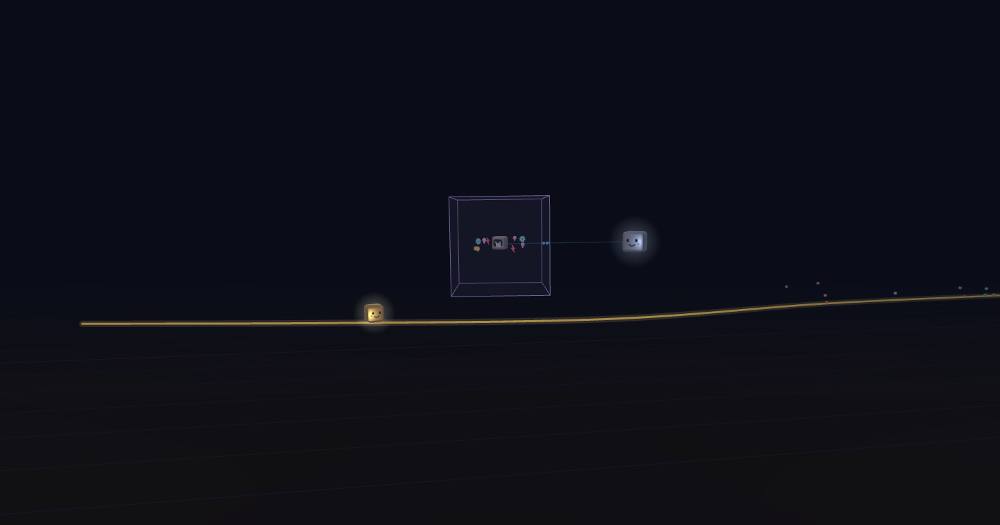

[Leer en español](README.es.md)



# STL Studio, the interface between you and the model

STL Studio is a small local web app that sits between you and an AI model and turns the model into your project's assistant director. Building alone, or in a small team, projects rarely die from a lack of ideas: they die from scattered attention. Ten chats open, half-finished plans, a «shall I proceed?» lost three sessions ago, and every new chat starting from zero, politely asking you to explain everything again.

The STL method fixes that with a single channel. Everything you tell the director (a comment, a voice note, a question, a decision) goes into the Studio. On each review, which only you request, the director reads it all, keeps the roadmap toward your goal and gives each person one mission at a time, with its why and a button to the exact place. You decide; the director proposes, orders the work and executes only what you approved, with tests and local commits.

The memory lives in your project's own repository, on a separate stl branch, so nothing depends on a chat's context: the model can forget, the project can't. Fewer tabs, more finished things.

Version 0.1.0. The repository is [ARGWABOT/STL-Sacred_Time_Line](https://github.com/ARGWABOT/STL-Sacred_Time_Line). The interface comes in English and Spanish.

## Start in three steps

1. **Download STL Studio** ([the latest version](https://github.com/ARGWABOT/STL-Sacred_Time_Line/releases/latest)), unzip it and open Claude Code in its folder.
2. **Ask it «initialize STL Studio»**: it installs everything and opens the Studio in your browser.
3. **Hand over your project** with «Hand over projects»: the director diagnoses it and gives you your first mission.

The details of each step are below, in «Install».

## Install

The installation is the same on any computer. The shortest way: download the Studio, open its folder with Claude Code and ask it to **«initialize STL Studio»**. The agent follows [INSTALL.md](INSTALL.md) from start to finish (in Spanish, [INSTALAR.md](INSTALAR.md)): it checks your computer, tells you what is missing, asks permission before installing each thing, turns the Studio on and opens it in your browser. You only say «yes» and give it your git identity. The package comes without its dependencies: the agent runs `npm install` when it initializes it.

By hand:

```bash
git clone https://github.com/ARGWABOT/STL-Sacred_Time_Line.git stl-studio
cd stl-studio
npm run iniciar
```

`npm run iniciar` checks Node, git and your identity, installs the dependencies and, if nothing is missing, turns the Studio on apart and opens it at **http://localhost:5180/** (the same as `npm run encender`). The first time, if this computer has no project of its own and no model chosen, the full-screen **installation assistant** opens: it checks your Claude Code session (if it is missing, it guides you and does not let you go on), asks for your Claude plan, leaves the recommended model and permissions checked, each with why and when it is needed, and with «Leave everything as it comes» you accept what is checked and see in a list what was left. **Whoever accepts everything with one click allows the director to push and publish**: uncheck what you do not want to give. Then it installs the transcription of your voice notes, which is required, with its progress, and asks you to read a sentence to see that it understands; if the download fails, it says whether it was the internet or the space, and without a microphone you go on all the same. Then it downloads the voices that read aloud by itself, three per language: they are part of the Studio, with no checkbox to skip them; if the download fails, it offers «Retry», and the only way to remove them is to uninstall the Studio. At the end, STL Studio is active and takes you to hand over your first project. If you close it halfway, it comes back where it was; you go over it whenever you want with «Review the installation», in «Model & usage», and «See it as a new user does», next to it, shows it as the first time, without saving anything.

The Studio keeps running even if you close the terminal or the agent, and if its server falls it comes back up by itself. After restarting the computer, run `npm run encender` again (if it is already on, it only opens it; if what is on is another copy of the Studio, from another folder, it turns that one off and turns this one on: a single Studio at a time). On Windows, without a terminal: double-click **`Abrir STL Studio.cmd`**, in the Studio's folder, which does the same (to keep it at hand: right click › Send to › Desktop).

### What it needs

- **Node.js 24** or newer and **git**, with your identity configured (`git config user.name` and `git config user.email`).
- Your git email is your place on each project's team: to change it later `git config` is not enough; run `node tools/cambiar-correo.ts <new email>` in the Studio's folder, which changes it in git and in each project's team at once.
- **Claude Code, with your own account.** The Studio launches the Claude Code you install and sign in to yourself; it does not offer the claude.ai sign-in, because Anthropic's documentation for its agent SDK does not let a third-party product offer it without their approval.
- **A wide screen**: the Studio is used on a computer with a screen at least 1350 pixels wide (a laptop or more). With less, a cover asks for a wider screen; there is no version for phones or tablets.
- **Internet, to install.** Your agent checks the disk before downloading anything, and the assistant says how much what it installs takes.

### What was tested

- **The agent**: only Claude Code is promised. Codex and Cursor are still to be tested.
- **The computer**: Windows 11 Pro, 64 GB of memory, AMD Ryzen 7 5800X, where the Studio is used every day. A note takes about as long to transcribe as it lasts. macOS and Linux are still to be tested, and so is an installation on a clean computer.
- **The account**: Claude's Max 20x plan, with Opus 5.5 at «High» effort, which in that use almost never reaches the five-hour limit or the weekly one. With a smaller plan, use Sonnet 5.5 and a shorter time limit in «Model & usage».
- **What a review uses**: an ordinary review uses about 1 % of the weekly limit of that plan. It is approximate, read from what the limit rose over a day and a half of reviews.

### After installing

1. Sign in once to the Claude Code CLI (`claude auth login`): that way «Request review» calls the director at once, without a screen. The director's session, for everything else, is Claude Code open **in the Studio's folder** (without the CLI, leave `/loop 5m /vigila` running there).
2. In the project selector (at the top of the sidebar), press **«Hand over projects»** and choose its folder. The director diagnoses it and proposes goals.
3. Read the diagnosis, comment on it part by part and **set your goal** in Project.
4. **Request review**: the director draws the roadmap and gives you your first mission. From there, the cycle: mission → mark its steps (the last one delivers it) → request review.

The first time, your Studio already comes with one project, **STL Studio**, fixed at the end of the list: it is your own Studio, with its diagnosis done, and you do not have to change anything. To adjust it to your way of working, select it and ask the director in the Inbox. Before each review of that project a local backup branch is left; if an adjustment leaves you without a Studio, go back to it from its folder:

```bash
git reset --hard respaldo/studio
```

### Updating

In 0.1.0 there is nothing to update from yet. From 0.2.0 on, the Studio offers it, with its report of what clashes with what you changed. A line at the foot of the sidebar, next to your name, says when there is a new version, with its link to its notes on GitHub and an ✕ that closes it until the next one: once a day the Studio asks GitHub which is the latest, without sending anything of yours or of your projects; it is turned off with its checkbox in «Model & usage».

## Why

Directing a weeks-long project by chat has six problems: what you send runs at once, correcting pollutes the context, every message costs the whole conversation, you cannot comment on a paragraph, what was reviewed gets rewritten and nobody decides what comes next. STL solves them with a method and an interface:

| In the chat | In STL Studio |
| --- | --- |
| You send and it is already running | Your comments wait in the **Inbox**: you correct or delete them before the review |
| You explain which part you mean | **You comment on the exact paragraph, step or decision** |
| Ten ideas, ten turns | **One grouped review**: the director answers each remark and says what it did with it |
| The model rewrites what was approved | **Always forward**: what was reviewed stays sealed; what changes arrives in a new document |
| You work on everything at once | **A roadmap with gates** and one mission at a time, toward the goal you set |

The full method is in [docs/metodo/metodologia.md](docs/metodo/metodologia.md), and in Spanish, in [docs/metodo/metodologia.es.md](docs/metodo/metodologia.es.md). At the foot of the sidebar, **«What is STL Studio»** opens the public animation that explains it in two minutes.

## What it brings

- **Handing over is choosing the folder**: the director diagnoses it and proposes goals (also several at once, the ones it finds when scanning your computer, or a new one).
- **Today**, the start: it opens with a click on the mark at the top of the sidebar. It shows what was last completed, what comes next and your current mission, whole, step by step, each step with its button to the exact place. If you delivered them all, it is never empty: it says your next step (requesting the review, with its button, or waiting for the one already running). What was delivered does not go back: a click on a mission waiting for the director unfolds its summary.
- **The middle mouse button, like an Enter**: in «Today», wherever the cursor is, it first opens «Where we left off» while it has lines to read and, with everything read, your current mission in focus mode; there, with no fog left to uncover, it takes you where its step asks (the document, the proposal or the place), never choosing an option for you. Anywhere else, it presses what is marked as next; and if there is nothing to uncover or press, it does what the director's face does: it takes you to «Today» and your current mission.
- **Today and the roadmap, one view**: on top, a thin roadmap bar that always says which phase you are in and how far along it is; below, your current mission, the queue folded and your card. What is not needed every day (the phase gate and its criteria, the past and coming phases, the phase plan and its approved missions, what was requested and the proposals) goes in the «Process data» tab, and a click on a phase in the bar opens that tab at that phase. Neither the reserve count nor the fronts are on screen. From «Where we left off», the middle button's «Go to what's next» opens your mission already in focus mode.
- **Documents you can comment on** by parts, with decisions answered one by one, written or recorded.
- **Each project's key files**: in «Documents», inside «Project documentation», are the files to know to understand the project (the director chooses them), with what each one is when you hover over it; and in «Project», under «What it is», as a short table of name and what it is for, which opens each one with a click.
- **Inbox and questions**: comments, requests and questions, in the Inbox; the answers to your questions are also read together, like a report with conversations you can continue, from the «Question» filter. The numbers on its tabs and filters count only what is waiting for the director or for your decision. Each note carries its type, which you choose with one tap when leaving it (it starts at «Auto (the model decides)», and you change it to adjustment, comment, idea for later, something fails or question; one left from the ✉ of a place is already marked as a comment, and the N key opens and closes that dialog), and until the director reads it you change the type with that same button, in the Inbox. The Inbox is filtered by type and by how it ended up; what was left to decide or postponed becomes integrated by itself when you settle it in its place. Everything you tell the director is written in a single dialog, which the N key opens over what you are looking at; if you close it without sending, it stays as a draft in your browser, and «Request review» reminds you of it first. When you come back, «Where we left off» brings what the director answered to your notes in tabs by type and, in «The roadmap», what advanced and its comments.
- **Request review**: one button, and the Studio calls the director at once. While you request nothing, no model runs. When requesting it is the only thing left to you, the button beats softly in the header. Each review goes in two times: first, a few minutes at medium effort and touching nothing, the director plans it as a list of assignments the Studio checks; then it works it, assignment by assignment, marking each one as it finishes. Meanwhile, «What the director is doing» is a conversation in balloons between the director and the model: who asks for what, how long it took and who waits for whom, with a chess clock below that adds up the time and the tokens Claude Code reports and, above it, the context avalanche: on a snowy slope, the director rides inside a snowball that catches the model and squashes it (the model reading everything again); the model struggles and, when it answers, throws the ball far back with a bounce, and the ball, a little bigger each time, chases it again, never stopping, while it moves down the slope as tasks get done; near the limit it hits a pine tree and splits (the summary), and what came from the cache shows as packed snow. It starts small again in the next review. Once the review is over, «↻ Replay the avalanche» shows it again, faster, with that review's stored times. While the review runs it is a full-height panel between the sidebar and the content, with the balloons rising from the characters at the bottom, and a click on the face of the director at work opens and closes it, with no strip left in view; when the review closes, it goes away. A review with a single note or delivery goes in one go. One director works at a time on each project: if another is reviewing, yours waits its turn, says so in the header and starts by itself.
- **Stopping and resuming**: the header says how long the director has been working and its limit in minutes. With «Stop now» you ask it to close with what it has; if it has not closed in three minutes, the Studio cuts it. Ten minutes before its limit the Studio warns it to close: if it is still advancing when it arrives, it gives it ten more minutes, once. If a review, a clarification or something urgent does not close, «Why?» says what happened, and «Resume it» asks for it again so the director finishes only what was missing.
- **A step outside, checked**: if you did something outside the Studio (pushing, setting up an account), «Done, check it» marks the step and the director checks it at once, apart from the review; you go on with yours and, if it was not met, the step comes back to you with what it found.
- **What it uses, on your plan**: the Studio works on your account, with Claude Code, never with an API key, and shows only usage: in «Model & usage», today's and the week's figures say the tokens and what part of your Claude week they used, approximate, with no money figure; if your five-hour limit is almost full, it tells you before you request a review. The director's helpers work with a model that uses less of your plan; with «Everything with the model I chose», with the same as it. Next to the chosen model, what Anthropic says about it, from a table of the Studio with its source and date, which warns if the model is not in it or if it is more than 60 days old.
- **Its judgment, written and measured**: the director decides with its own procedure ([docs/metodo/director/deciding.md](docs/metodo/director/deciding.md)), and «Model & usage» › «Usage» shows, per review, how what it recommended turned out: what you approved as is or changed, the missions to redo, the «I don't get it», whether it closed and its tokens.
- **Each review's history, in the big line**: the magnifier on the sidebar's line opens it; a click on a review shows what it planned and did, what it was denied, the other models it used and what for, and the urgent notes and clarifications that followed.
- **What you allow the director, ready before it is needed**: «Model & usage» › «Permissions» has a checkbox per kind of action (read, test, commit, push, pull, publish, install), each with its scope: marking it is the authorization, and what it never does stays out.
- **One GitHub account per project**: in «Project» › «Where it is» you write the account approved for that project; before pushing, pulling or publishing, the Studio asks GitHub whose session it is and, if it is not that one or none is set, it stops and tells you. In the same place you see the sessions gh saved on that computer, whose each one is according to GitHub and which one is active, and you switch sessions or sign in with another account without the terminal.
- **Your projects' skills, only with your permission**: the director loads no skill or command a project brings (its `.claude` folder) until you authorize it in «Model & usage» › «Permissions», where you first see what the Studio found in each one; if one of its files changes, it stops loading it until you authorize it again.
- **Several projects**, one active at a time: when you switch, the director tells you where they were left.
- **English and Spanish**: EN and ES, next to your name at the foot of the sidebar, change the language with one tap and it stays saved on your computer. Each document is read aloud with the voice of its language, whatever the interface's is.
- **Voice**: record your notes; they are transcribed on your computer, without outside services, in the language you speak (it detects it by itself); the director always answers in the language of your interface. An audio that could not be transcribed is not deleted: it stays queued and is tried again by itself.

## The live line

The whole sidebar is a galaxy, in both themes. In its free space, across its whole width, **the project's live line** undulates all the time, and on it you go, the little cube with a face, in the center: the line moves left, slowly with the clock and one step with each thing you leave the director. Each thing is born from you, in a branch of its type and color (a comment, an adjustment, an idea, a failure, a question, what you choose or decide, a delivery): its base stays where it was born, it rises or falls to its height and its head follows you in parallel; hovering over the head opens a balloon with the note that gave birth to it, and the line stays still while you read (the branches already joined in past reviews open none).

When you request the review the director appears at that point and you take a jump ahead, apart from it, because you can go on: what you leave while it reviews is born from you and waits for the next review. While it reviews you advance more slowly and the two share the center. It gathers the branches born before, their heads turn around it while it works, and a click on it opens what it is doing. At the close, the point stays marked, with those branches joining there (its history is saved in the project's memory, so your team sees the same), and your batch of missions is spread ahead on the line: as you deliver each one, you reach it.

In the bar it drags sideways to look at the line's past; when you let go, two seconds later it comes back to you at an even pace. In that past, the branch of what was left for a phase that has not arrived yet looks faint, with a dashed stroke, until its turn. In focus mode it sticks to the foot of the window, with more time in view, over the same sky. Its stars always advance, and faster when you advance (with «reduced motion», still); with many branches it grows upward before stacking their heads. Its «Hide the line» button, at the bottom right over the drawing, removes it and the window takes its space.

In the bar, a faint magnifier at its right corner, always in view, opens **the large line**: a window of 90 % of the screen with the same line and all its history, its branches and the strokes that join at each review, with the director's face on each one, in red those that did not close. The lines take up about 30 % of the height, with the sky in view and several reviews at once. It is dragged or moved with the wheel and does not come back by itself: a button in its corner takes it back to the present point. Hovering over a review, a balloon says its date and time and its report (how many branches you opened, how many the director joined into the line, how many wait for their phase and how many it closed; the same balloon opens over each review in the sidebar), and a click opens its history on the right, in two tabs: «Summary», with what it planned, what it did, its tokens and its approximate part of the plan, and «Conversation», which opens where the review ended, while its log exists. Each review is looked up there.

## How it works

```
 You ──▶ STL Studio (http://localhost:5180) ──▶ project memory ◀── the director's session (Claude Code)
         comment, deliver, decide               in ITS repository:       «Request review» or «revisa estudio»
                                                stl branch, .stl/ folder
```

The Studio keeps no data of your projects: the memory of each one (its plan, its inbox, its decisions, the director's documents) lives in **its own repository**, on a separate branch (`stl`) that the Studio opens in the `.stl/` folder. It does not mix with your code or run your continuous integration, and it goes up to the project's cloud only if you ask. The director is a Claude Code session open in the Studio's folder: when you request the review (or write **«revisa estudio»**), it reads everything pending, answers, adjusts the roadmap and leaves your next mission. Its rules are in [CLAUDE.md](CLAUDE.md) (and in [AGENTS.md](AGENTS.md) for other agents). The interface's design and its reasons: [docs/metodo/diseno-studio.md](docs/metodo/diseno-studio.md).

## Comments and questions, without leaving what you are doing

Next to the director's face (at the bottom right) there are shortcuts to tell it something (and, in a document or in your current mission, the one for focus mode; the review is requested at the top, in the header):

- **Comment**: an idea or something you want it to keep in mind. It does not enter the project at once: the director decides how and where to manage it (a mission, a proposal, a document or the roadmap) and answers you in the Inbox. If you later change your mind with another note, the earlier one is marked «Replaced» in the Inbox, and the director marks it when answering.
- **Questions**: you write them down when they come up, in the same dialog as a comment, choosing the type «Question», written or recorded. They wait in the Inbox, with the «Question» filter, where you correct or delete them, and the director answers them in its next review. In **Questions** each one is a folded conversation: you open it, read the answer and, if you want, continue it.

While you record, the dialog moves aside: you can read and move around the Studio while you talk.

Each key STL word in the interface (mission, reserve, phase, gate, criterion, front, seal, proposal, request, review and Inbox) carries a small **«?»**, always there: hover over it and it explains the word in one line; click it to keep it open (click again, click elsewhere or press Esc to close it).

No help starts by itself: the guided tours show only once you turn on the **help mode**, with its circle and its «?» in a speech bubble among the director's circles at the bottom right (always in view, also in focus mode, and above any tour). While it is on, its background is red and its «?» whole; off, the «?» is crossed out. With it on, the first time you open **Today** with a mission, the Studio offers a guided help of five balloons, one at a time (your mission, the buttons of each step, «Up next», the ✉ and «Request review»), with «Next», «Skip the help» or Esc; it does not repeat in your other projects. The **Inbox** and the **documents** bring theirs, four balloons each, the first time you open them with something to explain; so do **The roadmap** (four balloons) and **Model and usage** (three). The help mode also explains each part as you move the mouse over it and brings «See this section’s tour again»; the same button turns it off, and closes a tour in progress. The Studio's own tooltip for a button or a word shows only after the mouse rests two seconds on it, above any open window.

With the **reading fog** (the cloud next to the director's face), what the director wrote stays under fog and you uncover it with it, dragging it or with ▶. The card of your mission is uncovered all at once, its why and its step with a single ▶. What you go through stays noted for you on this computer, outside git and never forgotten: coming back days later, it is still uncovered. Nothing in the background interrupts what is being read, on screen or in the audio: what arrives is painted when it is free. «Fog it again», in the fog's strip, covers that screen again to reread it slowly, without erasing what you went through.

## Voice notes

They are part of the method, and writing is only the backup: transcription is required. They are recorded in the Studio and transcribed **as soon as you finish recording**, on your computer, with faster-whisper: nothing leaves your machine. Silences cannot be recorded: if no sound arrives in the first 8 seconds, the recorder stops by itself, discards what is empty and tells you, so you check your microphone. After that, pauses do not count: what already has sound is never lost. Meanwhile you see «Transcribing…»; when it is ready, what was understood appears where you recorded and in the Inbox, and you can correct it. While the director has not read it, «Correct» also lets you complete it by talking or redo a part: mark it before recording and what you say replaces it. With the text written, the audio is deleted: it never enters git or leaves your computer (if the transcription fails, it stays until it works, or until you write what you said).

The installation assistant installs it, on any system and without WSL. By hand, from the Studio's folder (on Windows, in Git Bash):

```bash
bash tools/entorno/instalar_transcripcion.sh
```

If uv is missing (Astral's free Python manager), it installs it. It is the same installation on any computer: it transcribes on the processor, and a note takes about as long as it lasts. The voices that read aloud are installed the same way, with `bash tools/entorno/instalar_voces.sh`; with the voice on, from the moment a review's report comes out the Studio prepares in the background the voice of what you will read next and saves it on the computer, up to 1 GB (over that, the oldest audio goes), so going from one to another does not wait. The Studio does not use WSL at all. While it is not installed, the Studio says so with this command, and the log in «Model & usage» notes each note it transcribes.

## Teams on several computers

Each person clones the Studio, sets their git identity and hands over their own clone of each project: if the project already has its `stl` branch (in its repository or on GitHub), the Studio opens it and goes on where it was left. The owner of each project adds each person in Project › The team, with their git email. Their card marks the languages they read (set by the owner or by the person): the director does not translate for them what is already in one of them, and puts more content in each review step. With an `origin` remote and «Push to GitHub by itself what each person decides» active in Project, each decision goes up by itself to the project's `stl` branch, without forcing anything, and what others did is brought every 30 seconds.

## Commands

| Command | What for |
| --- | --- |
| `npm run encender` | Turns the Studio on apart (it comes back up if it falls) and opens it; `-- --estado` says whether it is on and `-- --apagar` turns it off. If the server stops anyway, the open page shows a fixed warning (close the tab and double-click «Abrir STL Studio.cmd») until it is back, and «Where we left off» then tells you once when it crashed and its likely causes |
| `npm run estudio` | Opens the Studio in this terminal (it dies with it; useful for developing the Studio) |
| `npm run bandeja` | The director's review (the director's session runs it) |
| `npm run diagnosticar` | The X-ray of the active project's repository |
| `npm run estado -- <front or paths>` | Before a task in a project: is it in focus or on hold? |
| `node tools/iniciar.ts --diagnostico` | What is missing on this computer, without installing anything |
| `… --proyecto <id>` | Any of the tools, on a project other than the active one |
| `npm test` and `npm run typecheck` | The Studio's tests and types |

## Structure

| Folder | What is there |
| --- | --- |
| `estudio/src/` | The interface: a single page |
| `estudio/servidor/` | The local server (a Vite plugin): it reads and writes the state and signs each decision with your git identity |
| `src/director/` | The pure logic of the method: phases, gates, criteria, missions, seals and effort |
| `tools/director/` | The director's tools: the inbox, the X-ray, the state and the transcription |
| `plantilla/` | Where each project's memory is born |
| `docs/metodo/` | The methodology, the Studio's design and its evaluation |

## Contributing

STL Studio is maintained only by its author: it does not accept code changes from others (pull requests). Bug reports, yes: open an issue with the «Algo falla» form, which asks for your system, the Studio's version, what you did and what happened. And if you tried it, the «I made it / I got stuck on…» form tells whether your first project reached its diagnosis. Your own copy you can change as much as you want. See [CONTRIBUTING.md](CONTRIBUTING.md).

## Credits

The STL method was created by ARGWABOT (A Regular Guy With A Bunch Of Tokens). STL Studio, the interface between you and the model, is its base application, under the [PolyForm Shield 1.0.0](LICENSE) license: free to use, commercial projects included, and to change for your own use; what it does not allow is offering a product that competes with STL Studio, such as selling it or republishing it under another name.
